# Demo guide

How to present **cf-honeypot-html-identifier** to a customer who worries about scrapers cloning their site. Typical cases are phishing look-alikes, fake shops, and copied prices or content. The guide gives the story, every step with what to show and why it matters, the questions customers ask, and how to reset afterwards.

> [!IMPORTANT]
> This is an educational, defensive example, not a Cloudflare product (see the [disclaimer](README.md)). Demo it only against a site you operate, such as the fictional demo shop. The demo kit in [`demo/`](demo/README.md) copies and republishes a site.

## At a glance

| | |
|---|---|
| **Audience** | Security, fraud and brand-protection teams; web and platform owners |
| **Length** | 20 minutes core, plus 10 minutes of optional deep dives |
| **The story** | A scraper copies the site → the copy reports itself → Cloudflare builds the evidence → a person decides in Discord → enforcement at the edge |
| **Key message** | Every copied page carries a sealed, unforgeable identifier of *who fetched it*. Combined with discovery, an evidence pipeline and human approval, that turns "someone cloned us" into a decision you can act on. It's **one layer** on top of Bot Management, WAF and AI Crawl Control, not a replacement ([Defense in depth](README.md#defense-in-depth-do-this-first)) |

Placeholders below: `<honeypot-host>` is the honeypot deployment (for example `honeypot.automatic-demo.com`), and `<clone-host>` is the clone's hostname in a second zone.

## Before the demo

Do this the day before; a rehearsal takes about 30 minutes.

1. **The honeypot** is deployed on `<honeypot-host>` ([Quick start](README.md#quick-start)) with:
   - **Discord approvals**, with you in `DISCORD_APPROVER_IDS` ([setup](src/notify/discord/README.md));
   - **Cloudflare Access** on `/__hp/*`, with your identity in the people policy and the service token in `.env` ([setup](src/admin/README.md#cloudflare-access));
   - the **WAF block rule** and `honeypot_blocked` list, if you want to show Block.
2. **Check the tooling.** Both commands should succeed:
   ```bash
   npm run hp -- whoami
   ```
   ```bash
   npm run hp -- notify-test
   ```
   The first should show `"auth": "access"`. The second posts a Discord message; click **Check access** on it.
3. **Pick a scraper network.** The scraper's IP ends up in the evidence and can be decoyed or blocked. Run `demo/scrape.sh` from a phone hotspot or a cloud VM, not from the network you present from. A blocked IP is blocked on the whole honeypot host, admin API included.
4. **Build the clone.** In `demo/clone/wrangler.jsonc`, set a **fresh** clone hostname (for example `clone-2026-11-25.<test-zone>`); the honeypot notifies once per clone host. Then, from the scraper network:
   ```bash
   demo/scrape.sh
   ```
   ```bash
   npx wrangler deploy --config demo/clone/wrangler.jsonc
   ```
   The custom domain's certificate takes a minute; open `https://<clone-host>/` once to check. **Don't** open it in a browser after that, or the beacon fires before the demo. (A `curl` is fine: it doesn't run JavaScript.)
5. **Clean state.** Check that no demo IP is flagged and no case is open for `<clone-host>`:
   ```bash
   npm run hp -- flags active
   ```
   ```bash
   npm run hp -- cases
   ```
6. **Screens.** Arrange four views:
   - the demo shop;
   - the Discord channel;
   - a terminal in the repository;
   - the Cloudflare dashboard (Workflows, Security Events, Zero Trust).
7. **Fallback.** Have this guide open: if something fails live, show the screenshot for that step.

## The demo

Each step says what to **do**, what to **show**, and **why it matters** for the customer.

### 1 · The problem and where this fits (2 min)

**Do:** open the [How it works](README.md#how-it-works) diagram.

**Show:**
- the four stages: Mark, Discover, Investigate, Enforce;
- the orange boxes: a person decides before anything is enforced;
- the [Defense in depth](README.md#defense-in-depth-do-this-first) table.

**Why it matters:**
- Scrapers that get past bot defenses copy the site and republish it, often to phish the customer's users or undercut their prices. The usual question afterwards is "who did this, and what can we do?"
- This project answers it with evidence instead of guesses, and sits behind the edge defenses that should stop most scrapers first.

### 2 · An invisible identifier on every page (3 min)

**Do:**
1. Open `https://<honeypot-host>/` and view the page source.
2. Reload and compare.
3. Open `https://<honeypot-host>/__hp/whoami` and sign in through Access.
4. Open `https://<honeypot-host>/robots.txt`.

**Show:**
- In the source: the `<meta name="csrf-token" content="…">` value (91 characters), the hidden link to `/catalog/full-export`, and the `rum.js` script near `</body>`.
- After the reload, the meta value is different: every request gets its own token.
- After the Access login, `/__hp/whoami` shows what your own token holds: IP, ASN, country, data center, time, Ray ID, and bot score and JA4 with Bot Management. It also shows that you are signed in through Access.
- `robots.txt` disallows the hidden link for every crawler.

**Why it matters:**
- **Nothing is stored per request.** The page itself carries an AES-256-GCM sealed record of who fetched it, so it costs no database writes at any traffic level.
- **It blends in.** The markers look like ordinary page furniture (a CSRF token, a RUM script), so a copier has no reason to remove them.
- **It can't be faked or edited.** Only the customer's key opens a token, so a forged or altered one fails.
- **Polite crawlers are left alone.** Anything that follows the robots-disallowed link has chosen to ignore the site's rules.

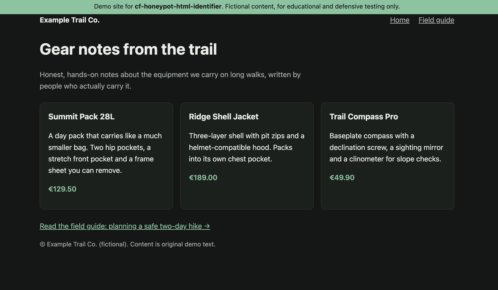
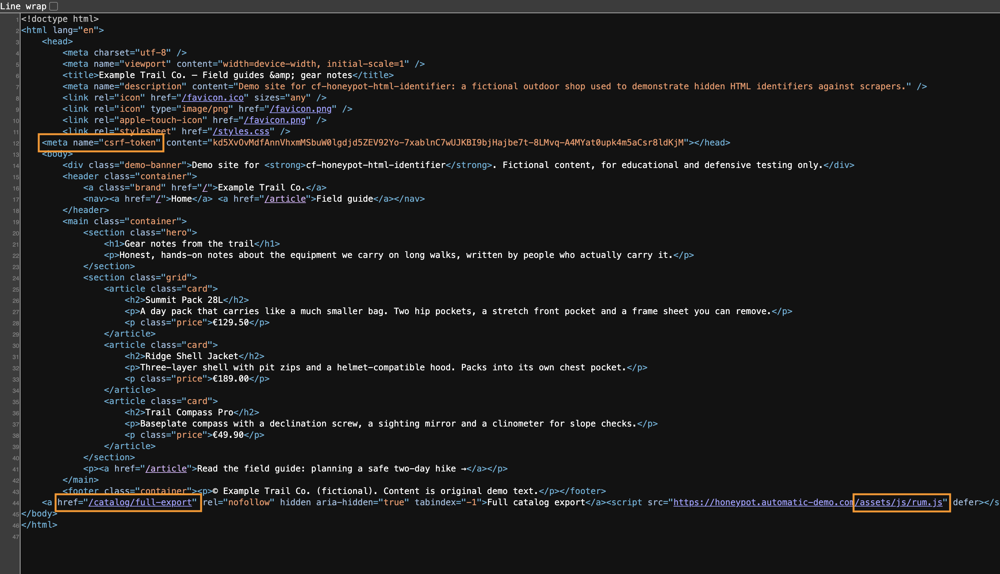
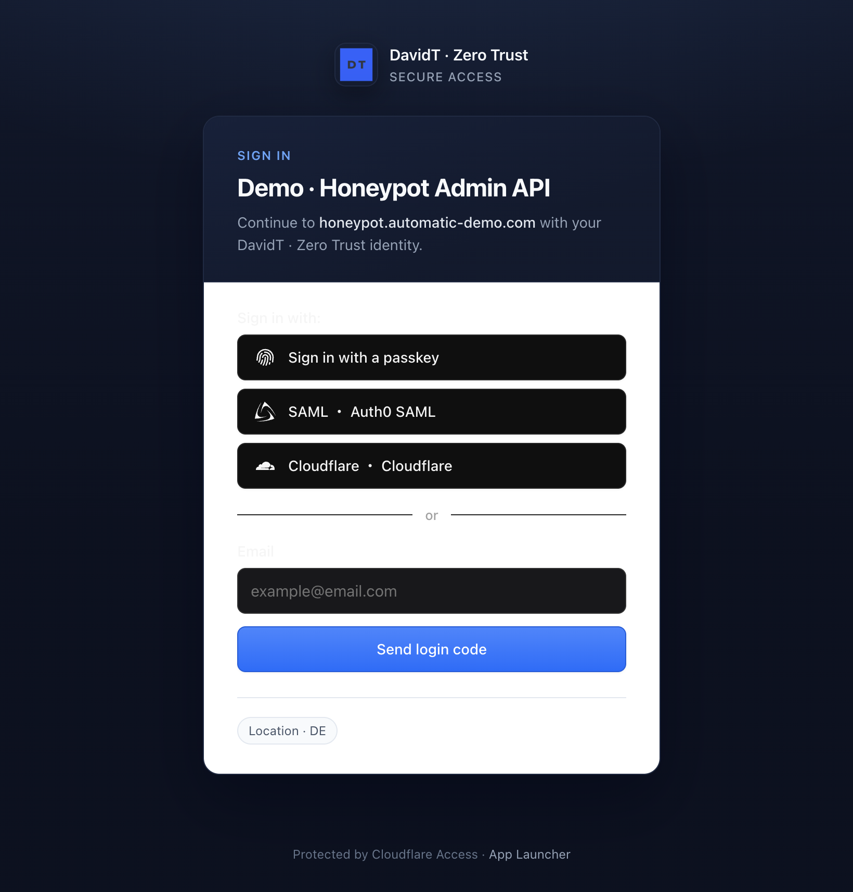
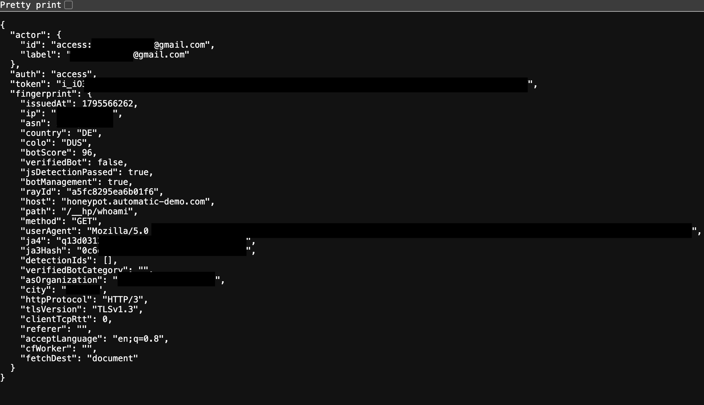
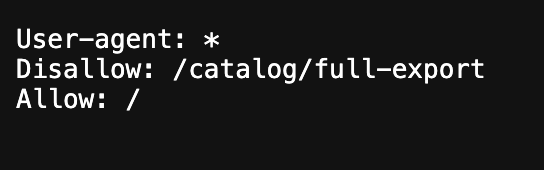

### 3 · The scraper (3 min)

**Do:** run the scraper from the scraper network. The copy you'll deploy was made with the same script earlier.
```bash
demo/scrape.sh
```
Then decode a scraped page offline:
```bash
npm run hp -- decode demo/clone/site/index.html
```

**Show:**
- The script reads robots.txt and ignores it.
- The hidden link takes about **5 seconds**: that's the tarpit, and the scraper received a fake "Catalog export".
- The decode output names the scraper's request: IP, ASN, network, data center, time and Ray ID.

**Why it matters:**
- Scrapers that ignore robots.txt walk into the trap. They get a **pending** flag and fake data, never an automatic block.
- The token in a copy is proof of *which request fetched the copied HTML*. The Ray ID connects it to the customer's own Cloudflare logs.

### 4 · The copy goes live and reports itself (3 min)

**Do:** open `https://<clone-host>/` in a browser, then switch to Discord.

**Show:**
- The rebranded copy ("TrailDeals Outlet") on a different domain.
- Within seconds, a **Clone lead** message in Discord: the clone host, the token's Ray ID, and **Investigate** / **Dismiss**.

**Why it matters:**
- The copied RUM script phones home from the clone and reports the token it found. The customer learns about the clone from the copy itself.
- **Privacy:** the beacon comes from an innocent visitor's browser, so nothing about that visitor is stored: no IP, User-Agent or Ray ID. Only the scraper's token is kept.
- Other discovery channels feed the same lead list: copies that hotlink the customer's assets (foreign Referers) and look-alike domains from Brand Protection.

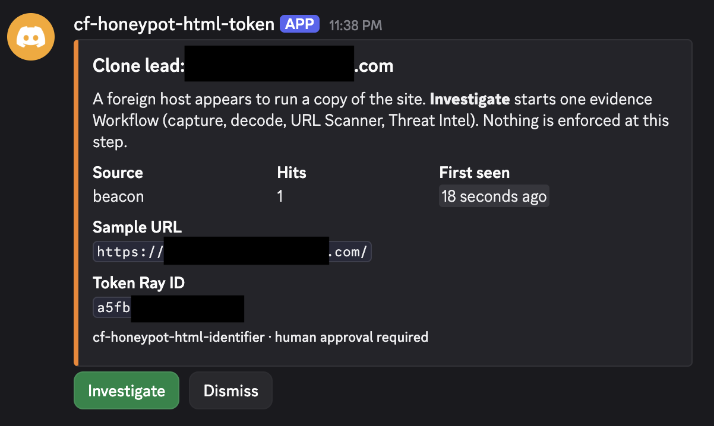

### 5 · A person approves, Cloudflare builds the evidence (4 min)

**Do:**
1. Click **Investigate** in Discord.
2. Open the Workflow instance: Cloudflare dashboard → Workflows → `honeypot-investigate` → the newest instance.
3. When the case message arrives, open the report and the abuse draft:
   ```bash
   npm run hp -- report <caseId>
   ```
   ```bash
   npm run hp -- evidence <caseId> abuse-report-draft.json
   ```

**Show:**
- The Discord message updates with the case ID and who approved it.
- The Workflow steps: capture, decode, hosting check, URL Scanner, Threat Intel, report, then *waiting for a human decision*.
- The **case message**: the attribution line (scraper IP, network, bot score, time), "copy confirmed", and **Decoy case IPs**, **Block case IPs** and **Close case, no action**.
- The report: capture hash, attribution, whether the copy is on Cloudflare, the URL Scanner link and Threat Intel. If the clone is on Cloudflare, there is a ready-to-review **abuse report draft** with no personal data.

**Why it matters:**
- Nothing happens until a person clicks.
- The clicks are verified (Ed25519 signatures and an approver allowlist), and concurrent clicks can't double-apply.
- The evidence is durable (R2, with a SHA-256 of the capture) and built by a Workflow that retries on its own.
- Paid lookups (URL Scanner, Threat Intel) run only for approved leads that carry a valid token.

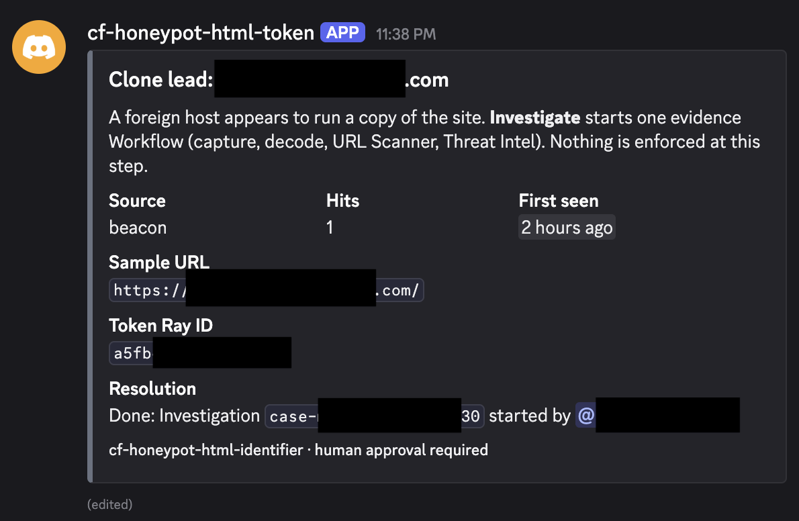
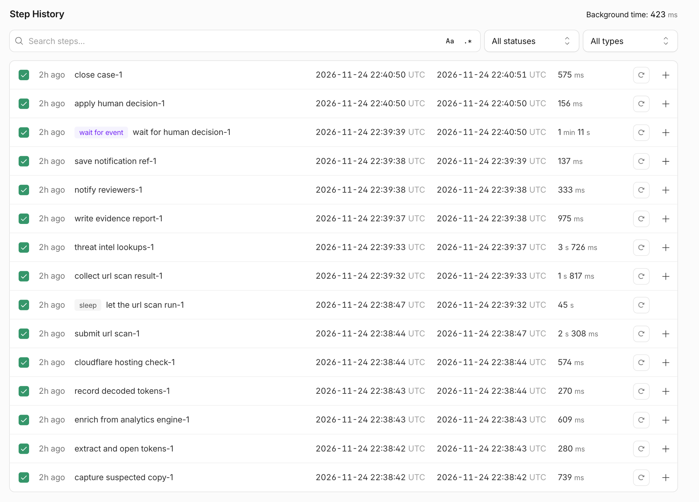
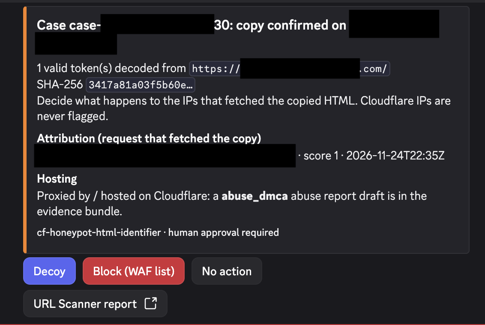
<sub>Captured with an earlier version: the buttons now read **Decoy case IPs**, **Block case IPs (WAF)** and **Close case, no action**.</sub>

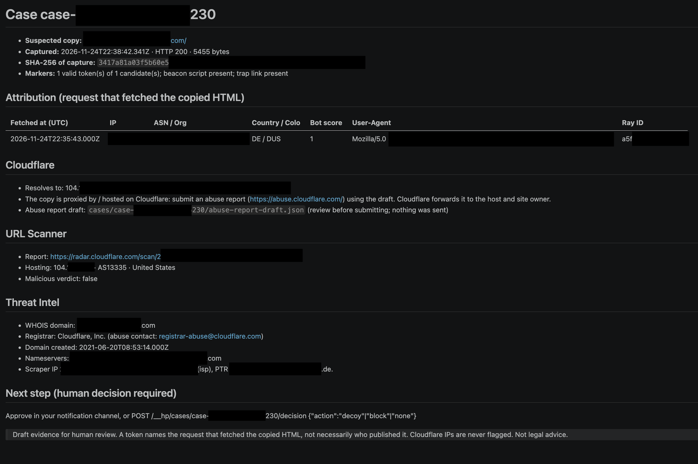
<sub>Current reports also have an **Evidence** line (confirmed, or unconfirmed when only the beacon reported a token).</sub>

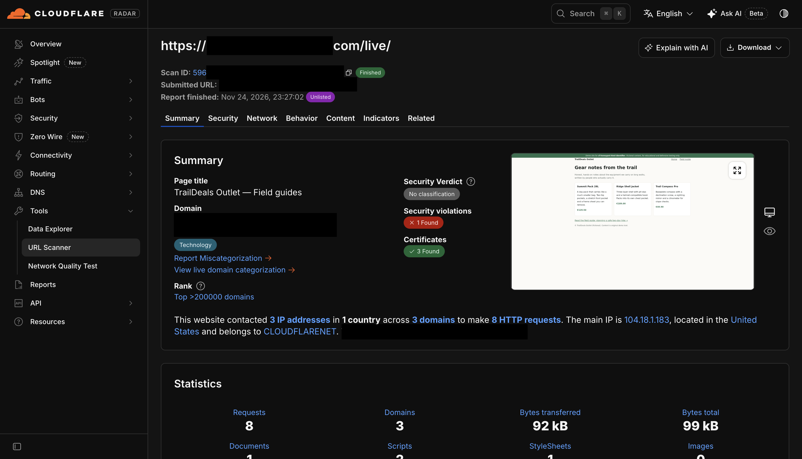
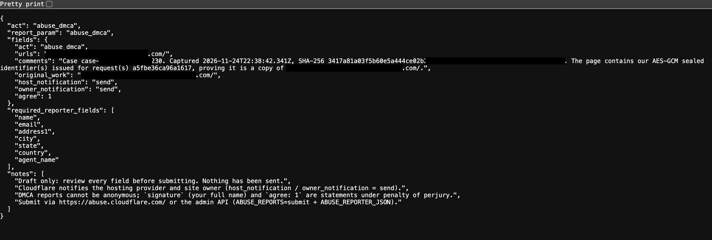
<sub>Captured with an earlier version: drafts no longer pre-fill `agree` (or `signature`); both are added only when a person submits.</sub>

### 6 · Decide and enforce (3 min)

**Do:** click **Decoy case IPs**. Then, from the scraper network, fetch the shop again:
```bash
curl -s -o /dev/null -w "%{http_code} in %{time_total}s\n" -A "Mozilla/5.0 (Macintosh) Chrome/142.0.0.0" https://<honeypot-host>/
```
To show **Block** (only on a scraper network that you can afford to have blocked):
1. Clear the decoy:
   ```bash
   npm run hp -- unflag ip:<scraper-ip>
   ```
2. Hit the trap again from the scraper network; this creates a new pending flag:
   ```bash
   demo/scrape.sh
   ```
3. Send the digest of pending trap flags:
   ```bash
   npm run hp -- notify-flags
   ```
4. Click **Block <scraper-ip>** in Discord, then repeat the `curl`.

**Show:**
- With Decoy, the scraper waits about 5 seconds and receives a believable fake catalog. Static files and everyone else are unaffected.
- The digest lists trap flags, one row per IP, with **Decoy <ip>**, **Block <ip>** and **Reject**.
- With Block, a `403` comes from the WAF before the Worker runs. Security Events shows the rule *Human-approved scraper IPs (list honeypot_blocked)*.

**Why it matters:**
- **Decoys** waste the scraper's time and poison its copy without tipping it off.
- **Blocks** are enforced at the edge by a WAF IP list, so they cost no Worker CPU. Both expire after 7 days by default.
- **Never Cloudflare IPs or verified bots.** Shared IPs make blocking blunt, so a person decides, and decoys are the gentler default.

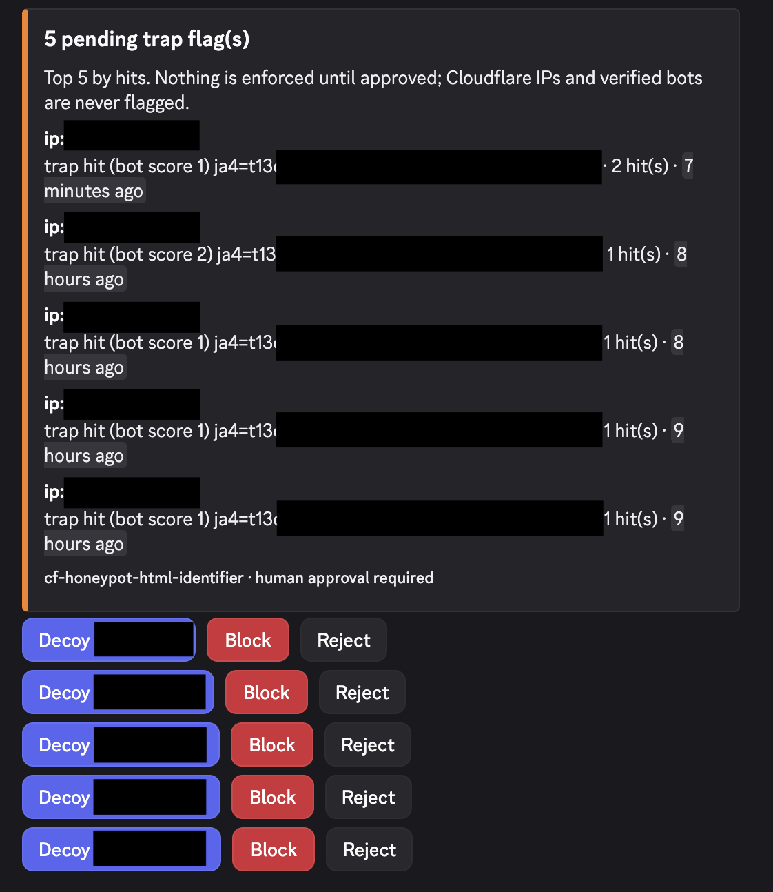
<sub>Captured with an earlier version: each row's Block button now names the IP too (**Block &lt;ip&gt;**).</sub>

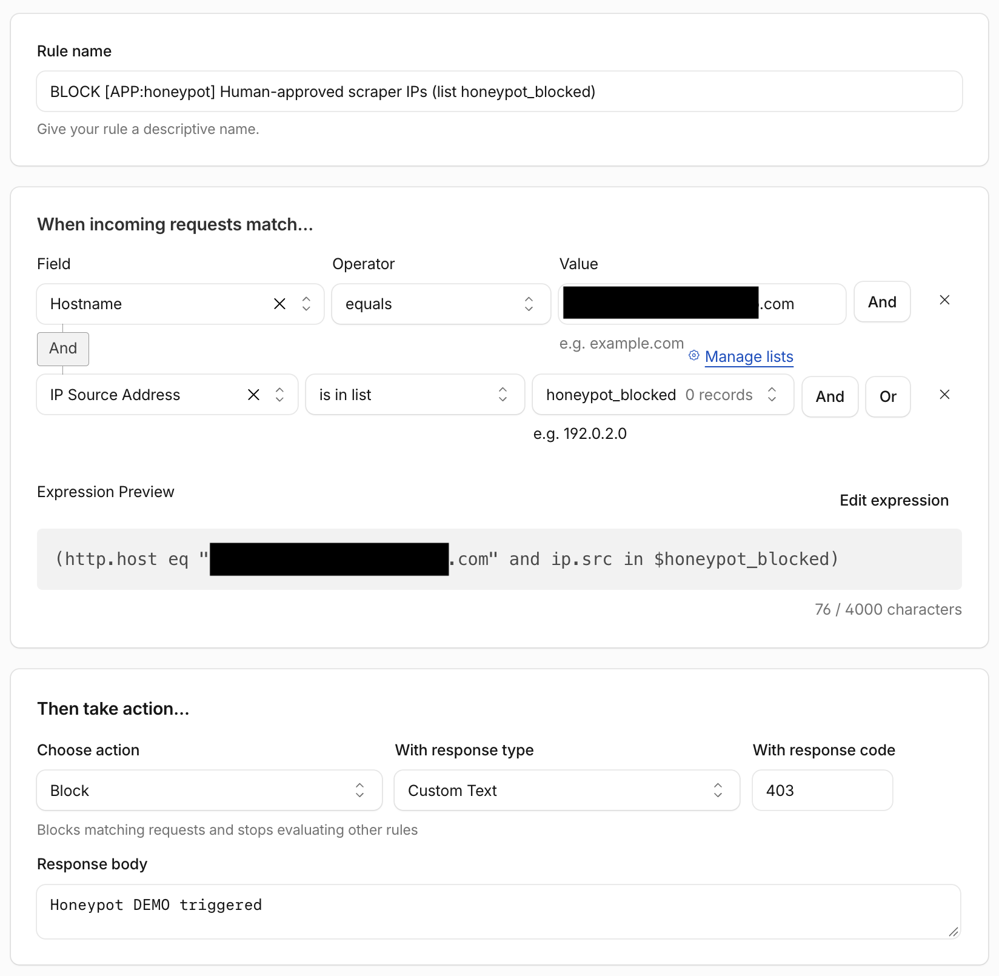
<sub>The recommended expression also ends with `and not cf.client.bot`, so verified bots are never blocked even if an IP is listed. The demo zone gets the same effect from an earlier rule that skips verified bots.</sub>

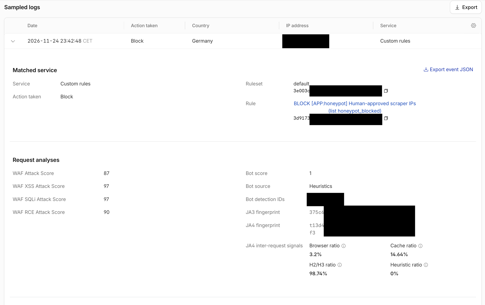

### 7 · Optional deep dives (5–10 min)

Pick what the audience cares about.

- **A mirror running on Workers.** Open `https://<clone-host>/live/`, the clone's reverse-proxy mode.
  - Its token names the proxy's Worker, a different scraper IP, so Discord gets a **Re-scraped clone** message. A re-scrape onto a known clone never goes unnoticed.
  - Click **Investigate**. The report marks a **live reverse proxy**, names the scraper's `CF-Worker` zone, and says the Cloudflare IP is never blocked.
  - The abuse draft names that zone, so Cloudflare can find the Worker.
- **A clone that hides from the investigator.** Some copies serve a clean page to anything that looks like an investigator. If a visitor's beacon reported a token anyway, the case arrives as **unconfirmed copy (beacon only)**, with no abuse draft until a person has verified the copy. Show the screenshot.
- **Governance.**
  - The admin API sits behind Cloudflare Access (an Owner login, or a service token for automation).
  - Decisions are attributed to the Access identity (`decided_by`).
  - Every endpoint is documented in [OpenAPI](src/admin/openapi.yaml).
  - A daily maintenance Workflow expires flags and reconciles the WAF list.
- **Under the hood.** The [request-phases diagram](README.md#where-each-request-is-handled) shows the WAF, then Access, then the Worker, and the [end-to-end sequence](README.md#a-scraped-page-end-to-end).

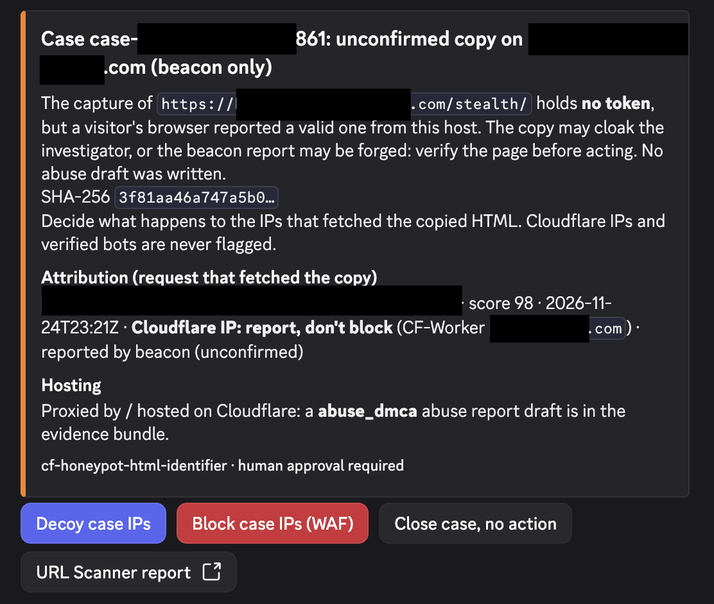
<sub>Its "Hosting" line still mentioned an abuse draft; since then it says that no draft is written for beacon-only evidence.</sub>

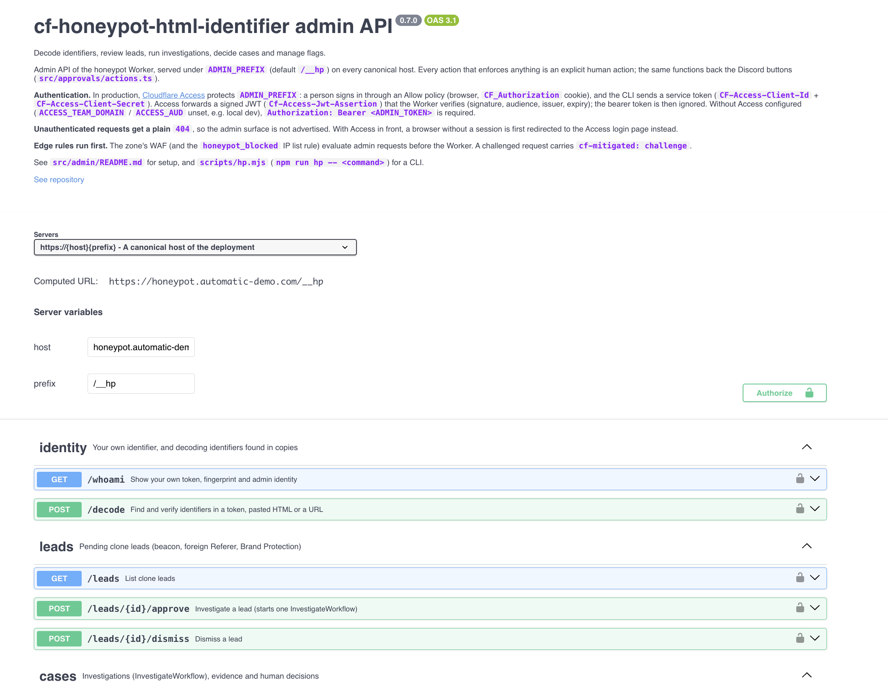
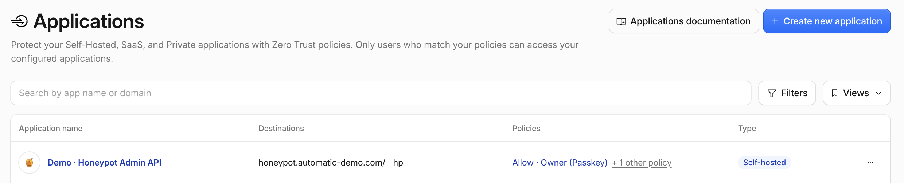

### 8 · Limits and next steps (2 min)

**Show:** the [Limitations](README.md#limitations) and the [scraper bypass table](README.md#how-scrapers-bypass-this-and-whats-done-about-it).

**Say:**
- **Determined scrapers can strip the markers**, and AI paraphrasing defeats every watermark. This is a tripwire with evidence for the verbatim copies that make up most clones.
- **Stopping scraping up front is a job for the other layers:** Bot Management, AI Crawl Control, WAF and rate limiting rules.
- **A token names who fetched the page**, not necessarily who published the copy, so every result is a lead for a person to review.

**Next step for the customer:** a proof of concept on one hostname:
1. edge rules first ([WAF get-started guide](https://developers.cloudflare.com/waf/get-started/));
2. the Worker on a route in front of their origin;
3. Discord or another chat channel for approvals;
4. Access on the admin path;
5. a two-week review of leads and trap flags.

## Questions customers ask

| Question | Answer |
|---|---|
| *Can't a scraper just remove it?* | A careful one can (see the bypass table). Most clones are verbatim copies or mirrors, and the markers are camouflaged as ordinary page furniture. Several independent tripwires (token, beacon, trap, hotlinks, [Brand Protection](https://developers.cloudflare.com/security-center/brand-protection/)) make a silent copy harder |
| *What about privacy and GDPR?* | IPs and User-Agents are personal data. Visitor data from clones is never stored; scraper data is kept for review. Retention, a legal basis and a privacy notice are the customer's call ([ROADMAP, production readiness](ROADMAP.md#production-readiness-review)) |
| *Will we block real users?* | Nothing is enforced without a person. Verified bots and Cloudflare IPs are never enforced on. Decoys are the gentle default, and flags expire after 7 days. Shared IPs (mobile carriers, VPNs, [iCloud Private Relay](https://github.com/DavidJKTofan/cf-icloud-private-relay-ip-list-manager)) are the main risk, and the report shows the network type |
| *Performance and cost?* | One indexed D1 read per HTML request (in parallel with the origin), a streaming HTML rewrite, and no per-request writes. Static files are untouched ([Scale and cost](README.md#scale-and-cost-millions-of-requests-per-day)) |
| *Which plan do we need?* | Workers plus **Enterprise Bot Management**. Bot Management isn't optional: it gives the Worker the verified-bot signals that keep search engines from ever being flagged, plus the bot score, JA4 and detection IDs in the evidence. URL Scanner, Threat Intel and Brand Protection are optional ([products](README.md#cloudflare-products-used)) |
| *Can it take the copy down?* | It drafts a Cloudflare abuse report when the copy is on Cloudflare, or points to the host and registrar otherwise. A person submits it: a DMCA report is a legal statement |
| *What about AI crawlers?* | They paraphrase, which defeats watermarks. Use AI Crawl Control and Bot Management to block or charge them before they copy anything |
| *Is it production-ready?* | It's an educational reference. [ROADMAP.md](ROADMAP.md) lists what to review before running it at scale |

## After the demo

```bash
npm run hp -- flags active
```

```bash
npm run hp -- unflag ip:<scraper-ip>
```

```bash
npm run hp -- cases
```

```bash
npm run hp -- decide <open-case-id> none
```

```bash
npx wrangler delete --config demo/clone/wrangler.jsonc
```

```bash
rm -rf demo/clone/site
```

Dismiss any pending demo lead with `npm run hp -- dismiss-lead <id>`. If the scraper network was blocked and you present from it, remove the list item in the dashboard: the block also covers the admin API on that IP.

## Screenshots

The images live in [`demo/screenshots/`](demo/screenshots/README.md), numbered in the order this guide uses them. To add one, keep the sequence (renumber the later files) and the naming pattern `NN-short-name.png`. **Redact** your IPs, email, Discord user IDs, Access team domain, AUD and service token IDs before committing; this repository is public.

| File | Step | Shows |
|---|---|---|
| `01-demo-site.png` | 2 | The demo shop's home page |
| `02-view-source-carriers.png` | 2 | Page source with the `csrf-token` meta tag, the hidden `/catalog/full-export` link and the `rum.js` script highlighted |
| `03-access-login.png` | 2 | The Cloudflare Access login page for the admin API |
| `04-whoami-browser.png` | 2 | `/__hp/whoami` after the login: `"auth": "access"` and the fingerprint |
| `05-robots-txt.png` | 2 | `robots.txt` with `Disallow: /catalog/full-export` |
| `06-discord-lead.png` | 4 | Discord **Clone lead** message with **Investigate** / **Dismiss** |
| `07-discord-investigate-clicked.png` | 5 | The lead message after the click ("Investigation case-… started by …") |
| `08-workflow-steps.png` | 5 | The `honeypot-investigate` instance's step history in the dashboard |
| `09-discord-case.png` | 5 | Discord case message: attribution, "copy confirmed", decision buttons |
| `10-evidence-report.png` | 5 | The evidence report (`report.md`) |
| `11-url-scanner.png` | 5 | The URL Scanner report of the clone |
| `12-abuse-draft.png` | 5 | `abuse-report-draft.json` |
| `13-discord-digest.png` | 6 | Discord pending-flags digest, one row per IP |
| `14-waf-block-rule.png` | 6 | The WAF custom rule on the `honeypot_blocked` list |
| `15-security-events.png` | 6 | Security Events: a request blocked by that rule |
| `16-discord-unconfirmed-case.png` | 7 | Discord **unconfirmed copy (beacon only)** case from the scraper's Worker |
| `17-openapi.png` | 7 | `src/admin/openapi.yaml` in Swagger UI |
| `18-access-app.png` | 7 | Zero Trust → Access → the admin application and its policies |

Not captured yet, and worth adding: the scraper run and offline decode (step 3), the clone in a browser (step 4), the decoy and the edge `403` seen by the scraper (step 6), and the live-proxy report and "Re-scraped clone" message (step 7).
