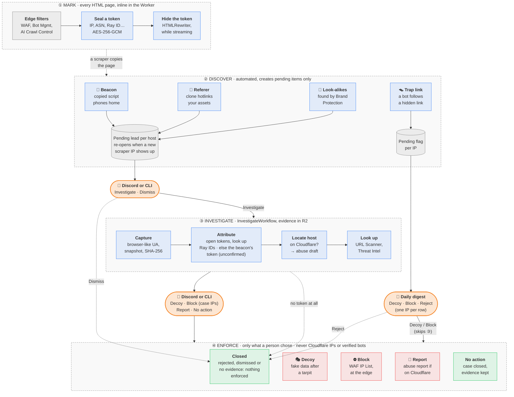
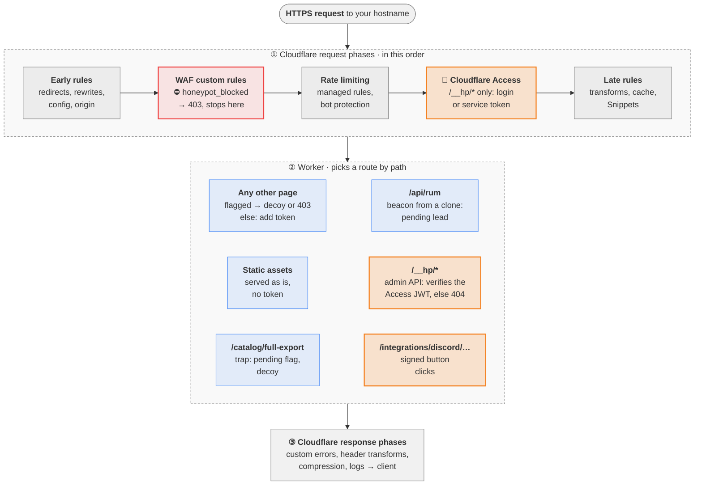
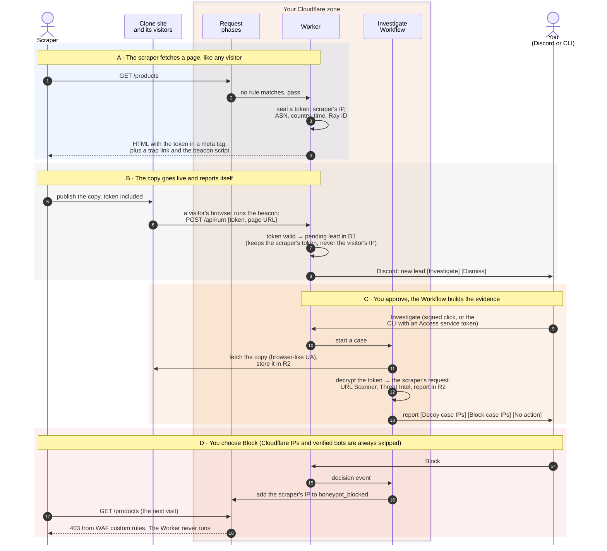

# cf-honeypot-html-identifier

A Cloudflare Worker that hides a **sealed, per-request identifier** in every HTML page. If someone copies the site, the copy still carries that identifier, and it tells you **which request fetched the copied HTML**: IP, ASN, country, data center, time, [Ray ID](https://developers.cloudflare.com/fundamentals/reference/cloudflare-ray-id/), and [Bot Management](https://developers.cloudflare.com/bots/plans/bm-subscription/) score and [JA4](https://developers.cloudflare.com/bots/additional-configurations/ja3-ja4-fingerprint/).

The same Worker:
- **finds clones** for you: a beacon, foreign-Referer monitoring, and [Brand Protection](https://developers.cloudflare.com/security-center/brand-protection/);
- **builds an evidence bundle** with [Workflows](https://developers.cloudflare.com/workflows/);
- **asks a human** in Discord (or any chat channel);
- **enforces only after you approve**, and never against Cloudflare's own [IP ranges](https://www.cloudflare.com/ips/) or verified bots.

Live demo: `https://honeypot.automatic-demo.com` (fictional site). **Presenting this to a customer?** [DEMO.md](DEMO.md) is a step-by-step demo script with talking points, and [`demo/`](demo/README.md) has the scraper and clone kit.

[](https://deploy.workers.cloudflare.com/?url=https://github.com/DavidJKTofan/cf-honeypot-html-identifier)

> [!IMPORTANT]
> **Disclaimer.** This is an educational, defensive example of how such a system *could* look at a high level, not a production product, and not an official Cloudflare product. It is provided as-is, without warranty of any kind, under the [MIT License](LICENSE): the authors accept no liability for any use of it. You are responsible for how you use it: IP addresses, User-Agents and similar signals are personal data in many jurisdictions (for example under GDPR), so make sure you have a legal basis, a privacy notice and a retention policy before deploying it. An identifier shows who *fetched* a page, not who *published* a copy. Treat every result as a lead for human review. Nothing here is legal advice, and it does not replace [Bot Management](https://developers.cloudflare.com/bots/plans/bm-subscription/), [WAF](https://developers.cloudflare.com/waf/) or [AI Crawl Control](https://developers.cloudflare.com/ai-crawl-control/) (see [Defense in depth](#defense-in-depth-do-this-first)).

**Contents:** [How it works](#how-it-works) · [Found a copy?](#found-a-copy-validating-the-identifier) · [Cloudflare products used](#cloudflare-products-used) · [Quick start](#quick-start) · [Admin API and CLI](#admin-api-and-cli) · [Configuration](#configuration-vars) · [Defense in depth](#defense-in-depth-do-this-first) · [Limitations](#limitations) · [Roadmap](#roadmap) · [Demo guide](DEMO.md) · [License](#license)

## How it works

The process has four stages. Only the first one runs on every request, and it writes nothing to a database. Discovery runs on its own but only records pending items. Investigating and enforcing each wait for a person to click a button.



<sub>🟦 automated · 🟧 waits for a person · 🟥 enforcement, only after approval · 🟩 no action · cylinders are D1 rows</sub>

What each Discord button does, what the flagged IP experiences, how long it lasts and how to undo it: [src/notify/discord/README.md](src/notify/discord/README.md#what-the-buttons-do).

### Where each request is handled

Every request to your hostname passes Cloudflare's [request phases](https://developers.cloudflare.com/ruleset-engine/reference/phases-list/) before the Worker runs, including the beacon, Discord's button clicks and your admin calls:
- **The block list** is a [WAF IP list](https://developers.cloudflare.com/waf/tools/lists/custom-lists/) used by a [WAF custom rule](https://developers.cloudflare.com/waf/custom-rules/), so a blocked IP never reaches the Worker, nor the Access login.
- **[Cloudflare Access](https://developers.cloudflare.com/cloudflare-one/access-controls/)** guards only `/__hp/*` (the admin API), after the WAF and bot phases.



<details>
<summary>Exact phase names</summary>

| Box | Phases, in execution order |
|---|---|
| Early rules | `http_request_dynamic_redirect`, `http_request_sanitize`, `http_request_transform`, `http_config_settings`, `http_request_origin` |
| WAF custom rules | `http_request_firewall_custom`: add `(http.host eq "<your-host>" and ip.src in $honeypot_blocked and not cf.client.bot)` → Block. Bot Management scores and AI Crawl Control rules can live here too |
| Rate limiting, managed rules, bot protection | `http_ratelimit`, `http_request_firewall_managed`, `http_request_sbfm` |
| Cloudflare Access | Internal: the application check runs after `http_request_sbfm`, and enforcement after Bulk Redirects. Only the admin app (`<your-host>/__hp`) is protected ([setup](src/admin/README.md#cloudflare-access)) |
| Late rules | `http_request_redirect`, `http_request_late_transform`, `http_request_cache_settings`, `http_request_snippets`, `http_request_cloud_connector` |
| Response phases | `http_response_firewall_custom`, `http_custom_errors`, `http_response_headers_transform`, `http_response_compression`, `http_log_custom_fields` |

Other internal phases (Waiting Room, API Shield, Managed Transforms) are left out. A terminating action (block, challenge) in any phase stops the request there. The Worker runs after [Snippets](https://developers.cloudflare.com/rules/snippets/) and [before the cache](https://developers.cloudflare.com/cache/interaction-cloudflare-products/workers/).

</details>

### A scraped page, end to end

One scraper, one clone, one decision, from top to bottom. In practice, the four parts can be days apart.



### What runs where, and why

| Stage | Runs on | What happens | Why it's built this way |
|---|---|---|---|
| **① Mark** | Worker ([`identity/`](src/identity/README.md)), on every HTML response | Seals the request's fingerprint into a 91-character token and injects it with [HTMLRewriter](https://developers.cloudflare.com/workers/runtime-apis/html-rewriter/) while the page streams. Writes one [Analytics Engine](https://developers.cloudflare.com/analytics/analytics-engine/) data point, indexed by Ray ID. | The copy carries its own attribution, so nothing has to be stored per request. Streaming adds no buffering. The data point keeps extra detail (User-Agent, JA4, path) for 3 months. |
| **② Discover** | Worker ([beacon](src/honeypot/README.md), trap) and the daily [`MaintenanceWorkflow`](src/workflows/README.md) (Referer, Brand Protection) | Records **pending** leads (per host) and flags (per IP) in [D1](https://developers.cloudflare.com/d1/), deduplicated and rate-limited with the [Rate Limiting binding](https://developers.cloudflare.com/workers/runtime-apis/bindings/rate-limit/). A beacon without a valid token never becomes a lead. | Automated signals are noisy: shared IPs, translators, archives. Nothing in this stage can block anyone. |
| **👤 Approve** | Discord bot ([`notify/`](src/notify/README.md)), or the CLI through [Cloudflare Access](src/admin/README.md#cloudflare-access) | Posts buttons. Each click is [Ed25519-verified](https://docs.discord.com/developers/interactions/receiving-and-responding) and checked against an approver allowlist, then handled by [`approvals/actions.ts`](src/approvals/README.md). | A person decides. Leads notify once per host, and trap flags arrive as one daily digest, so nobody gets flooded. |
| **③ Investigate** | [`InvestigateWorkflow`](src/workflows/README.md), evidence in [R2](https://developers.cloudflare.com/r2/) | Captures the copy with a browser-like User-Agent, decodes its tokens, checks over [DNS-over-HTTPS](https://developers.cloudflare.com/1.1.1.1/encryption/dns-over-https/make-api-requests/dns-json/) whether it is on Cloudflare, runs [URL Scanner](https://developers.cloudflare.com/radar/investigate/url-scanner/) and [Threat Intel](https://developers.cloudflare.com/security-center/intel-apis/), writes the report, then [waits](https://developers.cloudflare.com/workflows/build/events-and-parameters/) up to 7 days for a decision. | Durable steps retry on their own. Lookups that cost quota run only after approval and a valid token. If the capture holds no token but a visitor's beacon reported one, the case continues as **unconfirmed** (possible cloaking; no abuse draft). A copy with no token at all closes as `no_evidence`. Live reverse proxies are detected and named. |
| **④ Enforce** | D1 flag (decoy), [WAF IP List](https://developers.cloudflare.com/waf/tools/lists/custom-lists/) (block), [Abuse Reports API](https://developers.cloudflare.com/api/resources/abuse_reports/methods/create/) | Applies only the chosen action. Decoy and block flags expire after 7 days by default. | Blocks are enforced at the edge and cost no Worker CPU. Cloudflare IP ranges and verified bots are never flagged: a copy on Cloudflare gets an abuse report instead. |

The code is organized in modules, each with its own README; start at [`src/README.md`](src/README.md).

### The token and its carriers

**The token is the database.** A copied page carries its own attribution, encrypted with your key ([AES-256-GCM through Web Crypto](https://developers.cloudflare.com/workers/runtime-apis/web-crypto/)), so nothing is written to a database per request. Decrypting it proves your Worker issued that exact string; a forged or edited token fails.

| Carrier (`CARRIERS`) | Default | What a scraper copies | Survives |
|---|---|---|---|
| `meta` | on | `<meta name="csrf-token" content="…91 chars…">`, which looks like a framework CSRF token | verbatim clones, mirrors |
| `trap` | on | `<a href="/catalog/full-export" rel="nofollow" hidden …>`, a link humans never see. The Worker disallows it in this host's robots.txt for every crawler group, so polite crawlers skip it | n/a: bots that follow it anyway get a **pending** flag |
| `beacon` | on | `<script src="https://<your-host>/assets/js/rum.js" defer>`, which reports back when it runs on a foreign host | clones that keep or hotlink JS |
| `zw` | off | 272 zero-width characters inside the first paragraph | text-only scrapes (but quotes carry it too) |
| `form` | off | `<input type="hidden" name="_csrf">` before `</form>`, or `request_id` if the form already has a real `_csrf` field | verbatim clones |

### Blend in, don't hide

The carriers are **camouflaged, not concealed**. Each one looks like ordinary page furniture, so someone copying the page verbatim has no reason to remove it: a CSRF-style meta tag, a real-user-monitoring script, a hidden link that only bots follow. Be clear about what that does and doesn't buy:

| Copy method | Do the carriers survive? |
|---|---|
| Verbatim clone, mirror, reverse proxy, "save page as" | Yes. This is the main target, and the most common kind of copy |
| HTML minifiers, template re-skins that keep `<head>` and scripts | Usually (the meta tag and beacon script are kept) |
| Text extraction (Readability-style clean-up, HTML-to-Markdown, RSS scrapers) | Only the opt-in `zw` zero-width carrier, and only if the cleaner keeps those characters |
| AI rewriting or paraphrasing | No. **AI paraphrasing defeats every watermark** |
| A scraper that fetches twice and diffs | It can spot the meta value changing (a real CSRF token changes too) and strip it |

The proof doesn't depend on secrecy. A token is valid because only your key can produce it (AES-256-GCM): knowing how the scheme works doesn't let anyone forge or alter one. Secrecy only affects how often carriers survive. Treat the system as tripwires plus evidence for verbatim copies, and use [Bot Management](https://developers.cloudflare.com/bots/plans/bm-subscription/), [AI Crawl Control](https://developers.cloudflare.com/ai-crawl-control/) and [rate limiting rules](https://developers.cloudflare.com/waf/rate-limiting-rules/) to stop scraping up front. Carriers that survive more clean-up (asset URLs, `data-*` attributes) are on the [roadmap](ROADMAP.md#detection-quality).

## Found a copy? Validating the identifier

1. **Find:** use a pending lead (`npm run hp -- leads`; its [source](src/approvals/README.md#lead-sources) says how strong the signal is), or a URL you found yourself.
2. **Quick check** (no evidence stored):
   ```bash
   npm run hp -- decode https://suspected-clone.example/page
   ```
   ```bash
   npm run hp -- decode ./saved-page.html
   ```
   You can also pass the raw token instead of a URL or file. The tool finds every carrier, including renamed meta tags and zero-width runs, decrypts each token, and looks up its Ray ID in Analytics Engine. If a URL answers with an error instead of a page (for example `530`, Cloudflare error `1016`), `fetched.error` says so: nothing was checked, so `candidates: 0` proves nothing.
3. **Investigate** (evidence bundle in R2):
   ```bash
   npm run hp -- approve-lead <id>
   ```
   or, for a URL you found yourself:
   ```bash
   npm run hp -- case <url>
   ```
   The Workflow:
   - captures the page (with a browser-like User-Agent) and its SHA-256;
   - decodes the tokens. If the copy hides them from the capture but a visitor's beacon reported one, the case continues as **unconfirmed**;
   - flags a **live reverse proxy**, naming the scraper's `CF-Worker` zone when it runs on Workers;
   - runs URL Scanner (screenshot, HAR) and Threat Intel (WHOIS, domain, IP);
   - writes `report.md` and `report.json` ([how to read a report](src/workflows/README.md#reading-a-report)).

   Read it with:
   ```bash
   npm run hp -- report <caseId>
   ```
   The Workflow also checks over DNS-over-HTTPS whether the copy is **proxied by or hosted on Cloudflare**. If it is, it writes a Cloudflare **abuse report draft** ([details](src/integrations/cloudflare/README.md#abuse-reports)); otherwise the report points you to the host and registrar.
4. **Decide.** Click **Decoy case IPs**, **Block case IPs** or **Close case, no action** in Discord, or run:
   ```bash
   npm run hp -- decide <caseId> decoy
   ```
   The action is `decoy`, `block` or `none`. Nothing is enforced, and no takedown or abuse report is sent, without this step. Cloudflare IPs and verified bots are always skipped.

Sample attribution row (values anonymized):

```
| Fetched at (UTC)         | IP           | ASN / Org         | Country / Colo | Bot score | Ray ID           |
| 2026-11-24T13:45:33.000Z | 203.0.113.42 | 64496 Example ISP | DE / DUS       | 1         | 8c1a2b3c4d5e6f70 |
```

## Cloudflare products used

Availability and limits depend on your plan. Check [Cloudflare plans](https://www.cloudflare.com/plans/) and each product's documentation.

**Core (required)**

| Product | What it does here |
|---|---|
| [Bot Management](https://developers.cloudflare.com/bots/plans/bm-subscription/) (Enterprise) | **Required for verified-bot protection.** It gives the Worker the verified-bot signals (`request.cf.botManagement.verifiedBot`, `request.cf.verifiedBotCategory`) that keep search engines and other [verified bots](https://developers.cloudflare.com/bots/concepts/bot/verified-bots/) from ever being flagged, decoyed or blocked. It also puts the bot score, JA3/JA4, detection IDs and JavaScript-detection result into the token, and lets the trap skip likely humans. Without it, those signals are absent, so the Worker can't tell a verified bot from a scraper: verified bots that hit the trap become pending flags, and case decisions can't skip them. Only the edge rule's `not cf.client.bot` (all plans) still keeps them out of blocks ([details](src/approvals/README.md#verified-bots)) |
| [Workers](https://developers.cloudflare.com/workers/) | Runs everything: seals and injects tokens, serves the trap, decoy, beacon, admin API and Discord endpoint, and hosts both Workflows |
| [Custom domain](https://developers.cloudflare.com/workers/configuration/routing/custom-domains/) or [route](https://developers.cloudflare.com/workers/configuration/routing/routes/) | Puts the Worker on your hostname, behind your zone's WAF and Bot Management. The zone must be on Cloudflare, and the route must cover `/robots.txt` and every path in [Configuration](#configuration-vars) |
| [HTMLRewriter](https://developers.cloudflare.com/workers/runtime-apis/html-rewriter/) | Streams the carriers into HTML without buffering, and extracts them from copies (built into Workers) |
| [Web Crypto](https://developers.cloudflare.com/workers/runtime-apis/web-crypto/) | AES-256-GCM tokens, Ed25519 Discord signatures, constant-time compares, randomness (built into Workers) |
| [Secrets](https://developers.cloudflare.com/workers/configuration/secrets/) | `TOKEN_KEY`, the optional `TOKEN_KEYS` key ring, `ADMIN_TOKEN`, account and Discord IDs, API and bot tokens. The ring can live in [Secrets Store](https://developers.cloudflare.com/secrets-store/) instead ([key rotation](src/identity/README.md#key-rotation)) |
| [D1](https://developers.cloudflare.com/d1/) with [read replication](https://developers.cloudflare.com/d1/best-practices/read-replication/) | Flags, leads, cases and decoded tokens. One indexed read per HTML request through the Sessions API. Turn on read replication; it's off by default |
| [Workers Analytics Engine](https://developers.cloudflare.com/analytics/analytics-engine/) | One data point per tokenized page and honeypot event (User-Agent, JA4, path…), kept 3 months, indexed by Ray ID |
| [Analytics SQL Workers binding](https://developers.cloudflare.com/analytics/sql-api/workers-binding/) | Reads Analytics Engine from the Worker (Ray ID enrichment, daily hotlink leads) without an API token. Remote only, so tests skip it |
| [Workflows](https://developers.cloudflare.com/workflows/) | `InvestigateWorkflow`: a durable evidence pipeline that [waits up to 7 days](https://developers.cloudflare.com/workflows/build/events-and-parameters/) for a human decision. `MaintenanceWorkflow`: a [daily schedule](https://developers.cloudflare.com/workflows/build/trigger-workflows/) |
| [R2](https://developers.cloudflare.com/r2/) | Evidence bundles: snapshot, `report.json` and `report.md`, screenshot, Intel, abuse-report draft, decision |
| [Rate Limiting binding](https://developers.cloudflare.com/workers/runtime-apis/bindings/rate-limit/) | Five limiters that bound every public path that writes to D1 or sends a notification |
| [Workers Logs](https://developers.cloudflare.com/workers/observability/logs/workers-logs/) and [traces](https://developers.cloudflare.com/workers/observability/traces/) | Structured JSON logs and sampled traces (recommended; set in `observability`) |
| [Static Assets](https://developers.cloudflare.com/workers/static-assets/) | Serves the fictional demo site. Demo only: remove it in front of a real origin |

**Optional integrations** (most need the `CF_API_TOKEN` secret)

| Product | What it does here |
|---|---|
| [WAF custom rules](https://developers.cloudflare.com/waf/custom-rules/) and [IP lists](https://developers.cloudflare.com/waf/tools/lists/custom-lists/) | The `honeypot_blocked` list and one block rule enforce approved blocks at the edge, before the Worker. Without them, the Worker answers `403` itself |
| [Threat Intel APIs](https://developers.cloudflare.com/security-center/intel-apis/) | WHOIS, domain and IP intel in the case report |
| [URL Scanner](https://developers.cloudflare.com/radar/investigate/url-scanner/) | Unlisted scan, screenshot and hosting details of the copy |
| [Brand Protection](https://developers.cloudflare.com/security-center/brand-protection/) | Daily intake of look-alike domains as pending leads |
| [Abuse Reports API](https://developers.cloudflare.com/api/resources/abuse_reports/methods/create/) | Submits the drafted report after a human click. Off by default (`ABUSE_REPORTS="draft"`) |
| [1.1.1.1 DNS over HTTPS](https://developers.cloudflare.com/1.1.1.1/encryption/dns-over-https/make-api-requests/dns-json/) | Checks whether a copy resolves to Cloudflare (then the right channel is an abuse report). No setup |
| [Cloudflare IP ranges API](https://developers.cloudflare.com/api/resources/ips/methods/list/) | Cloudflare's own ranges are never flagged or blocked. No setup; a bundled snapshot is the fallback |

**Recommended alongside**

| Product | Why |
|---|---|
| [Cloudflare Access](https://developers.cloudflare.com/cloudflare-one/access-controls/) | SSO and service tokens in front of the admin API (`/__hp/*`); the Worker verifies the Access JWT and the bearer token is no longer needed ([setup](src/admin/README.md#cloudflare-access)) |
| [AI Crawl Control](https://developers.cloudflare.com/ai-crawl-control/) and [managed robots.txt](https://developers.cloudflare.com/bots/additional-configurations/managed-robots-txt/) | Block or charge AI crawlers before they copy anything. Cloudflare prepends its directives to the robots.txt the Worker returns, and the trap rule is kept |
| [Managed IP Lists](https://developers.cloudflare.com/waf/tools/lists/managed-lists/) | VPN and anonymizer membership, to judge shared IPs before approving a block |

### Scale and cost (millions of requests per day)

- **Per HTML request:** one indexed D1 read ([Sessions API with read replicas](https://developers.cloudflare.com/d1/best-practices/read-replication/); it runs in parallel with the origin fetch), one non-blocking Analytics Engine write, and a few µs of AES-GCM. Static assets skip all of it.
- **Bounded public writes.** Each public path that can write to D1 has a per-key and a global [rate limit](https://developers.cloudflare.com/workers/runtime-apis/bindings/rate-limit/) (counted per Cloudflare location):

  | Binding | Key | Limit | Guards |
  |---|---|---|---|
  | `BEACON_LIMITER` | clone host, and token Ray ID (valid tokens); clone host for invalid reports, on a separate key | 10 / min each | lead upserts from one clone, one token fanning out to invented hosts, and forged reports draining a real clone's budget |
  | `LEAD_LIMITER` | global | 30 / min | all beacon lead upserts |
  | `TRAP_LIMITER` | IP | 2 / min | pending-flag upserts from one IP |
  | `TRAP_GLOBAL_LIMITER` | global | 30 / min | pending-flag upserts from a crawl spread over many proxy IPs |
  | `NOTIFY_LIMITER` | global | 20 / min | approval notifications |

- **No per-request writes.** D1 only holds flags, leads and cases. These are deduplicated, rate-limited with the [Workers Rate Limiting binding](https://developers.cloudflare.com/workers/runtime-apis/bindings/rate-limit/), and expired daily. Analytics Engine keeps request detail for [3 months](https://developers.cloudflare.com/analytics/analytics-engine/limits/); the token itself never expires.
- **Threat Intel quota:** Intel calls ([2,500 a month on Enterprise](https://developers.cloudflare.com/security-center/intel-apis/limits/), shared with Brand Protection) run only after a human approves a lead *and* a valid token is found.
- **No runaway Workflows:**
  - Investigations start only on approval, with at most one open case per host and 5 running at once ([concurrency limit](https://developers.cloudflare.com/workflows/build/concurrency-limits/); instances waiting for a decision don't use a slot).
  - Lead notifications are sent once per host and rate-limited.
  - Trap flags arrive as one daily digest.
- **WAF list writes are batched and confirmed.** A case decision makes one bulk write, waits for the [bulk operation](https://developers.cloudflare.com/api/resources/rules/subresources/lists/subresources/bulk_operations/methods/get/), and retries `429`. Expired blocks are removed from the list before their D1 row is deleted, and a daily reconcile removes leftovers. Lists hold up to [10,000 items on Free–Business and 500,000 on Enterprise](https://developers.cloudflare.com/waf/tools/lists/#availability), across all lists.
- **Cloudflare stays working:** addresses from <https://api.cloudflare.com/client/v4/ips> are never flagged, decoyed or listed. If a scraper runs on Cloudflare (for example in a Worker, identified by the [`CF-Worker`](https://developers.cloudflare.com/fundamentals/reference/http-headers/#cf-worker) zone), file an [abuse report](https://developers.cloudflare.com/fundamentals/reference/report-abuse/) instead.

## Quick start

The steps below deploy the demo. Then work through the optional steps you need, and read [Defense in depth](#defense-in-depth-do-this-first) before going live.

### Install and configure

```bash
npm install
```

```bash
cp .dev.vars.example .dev.vars
```

Fill in `TOKEN_KEY` (generate it with `openssl rand -base64 32`) and `ADMIN_TOKEN`. In production, also set the `TOKEN_KEYS` key ring and rotate it on a schedule sized to your traffic, by hand with `npm run token-keys` ([key rotation](src/identity/README.md#key-rotation)). Also fill in the account-specific IDs (`ACCOUNT_ID`, `WAF_LIST_ID`, `DISCORD_*`). They are uploaded as [**secrets**](https://developers.cloudflare.com/workers/configuration/secrets/), so they never appear in the repo.

```bash
cp .env.example .env
```

Set `CLOUDFLARE_ACCOUNT_ID` in `.env`. Wrangler reads it from there ([system environment variables](https://developers.cloudflare.com/workers/wrangler/system-environment-variables/)), so `wrangler.jsonc` has no `account_id`. Later, the admin CLI's Access service token goes here too, never in `.dev.vars`, which `--secrets-file` uploads as Worker secrets.

`wrangler.jsonc` also contains no resource IDs. On the first deploy, Wrangler [provisions](https://developers.cloudflare.com/workers/wrangler/configuration/#automatic-provisioning) the D1 database and R2 bucket by name, and later deploys reuse the existing bindings.

### Test and deploy

```bash
npm test
```

```bash
npm run typecheck
```

```bash
npm run lint
```

Tests run offline in workerd. Lint runs [oxlint](https://oxc.rs/docs/guide/usage/linter.html)'s type-aware promise rules: the [Workers best practices](https://developers.cloudflare.com/workers/best-practices/workers-best-practices/#always-await-or-waituntil-your-promises) ask for every promise to be awaited, returned or passed to `ctx.waitUntil()`. It also checks that production `CANONICAL_HOSTS` lists no local host. [CI](.github/workflows/ci.yml) runs all three on every pull request.

For local development, `npm run dev` runs `wrangler dev --env dev`. The `dev` [environment](https://developers.cloudflare.com/workers/wrangler/environments/) in `wrangler.jsonc` adds `localhost` and `127.0.0.1` to `CANONICAL_HOSTS`. The top level, which `npm run deploy` uses, never lists them, because the beacon script embeds that list in every page. Environments don't inherit bindings or vars, so `env.dev` repeats them: change both (`npm run lint` fails if they drift). Apply the schema locally first with `npm run db:migrate:local`.

First deploy (this [provisions](https://developers.cloudflare.com/workers/wrangler/configuration/#automatic-provisioning) D1 and R2 and uploads every secret in `.dev.vars`):

```bash
npx wrangler deploy --secrets-file .dev.vars --env=""
```

Then apply the schema:

```bash
npm run db:migrate:remote
```

Turn on [D1 read replication](https://developers.cloudflare.com/d1/best-practices/read-replication/). It is off by default, and without it every flag lookup goes to the primary database's region. Use the dashboard (**D1 → your database → Settings → Enable Read Replication**), or the [D1 API](https://developers.cloudflare.com/api/resources/d1/subresources/database/methods/edit/) with a token that has **D1 Edit**:

```bash
curl -X PUT "https://api.cloudflare.com/client/v4/accounts/$CLOUDFLARE_ACCOUNT_ID/d1/database/<DATABASE_ID>" \
  -H "Authorization: Bearer $CLOUDFLARE_API_TOKEN" -H "content-type: application/json" \
  --data '{"read_replication": {"mode": "auto"}}'
```

Later deploys apply new migrations first, then deploy:

```bash
npm run deploy
```

Before a live test, check that production matches `main`:

```bash
npm run doctor
```

It fails if the deployed code is older than the last commit on `main` that changes what gets deployed (deployments made by `wrangler secret put` don't count), if production was rolled back, or if the remote database has unapplied migrations.

### Optional: Cloudflare API integrations and WAF blocking

To turn on WAF List sync, URL Scanner, Threat Intel and Brand Protection intake, [create a scoped API token](https://developers.cloudflare.com/fundamentals/api/get-started/create-token/) with **Account Filter Lists Edit, Intel Read, URL Scanner Edit**, then:

```bash
npx wrangler secret put CF_API_TOKEN --env=""
```

For WAF blocking:
1. Create an [account IP list](https://developers.cloudflare.com/waf/tools/lists/custom-lists/) (for example `honeypot_blocked`) and store its ID as the `WAF_LIST_ID` secret.
2. Add a [custom rule](https://developers.cloudflare.com/waf/custom-rules/) that [uses the list](https://developers.cloudflare.com/waf/tools/lists/use-in-expressions/): `(http.host eq "<your-host>" and ip.src in $honeypot_blocked and not cf.client.bot)` → Block. The [`cf.client.bot`](https://developers.cloudflare.com/ruleset-engine/rules-language/fields/reference/cf.client.bot/) clause (all plans) keeps verified bots out even if one of their IPs is ever listed ([how verified bots are handled](src/approvals/README.md#verified-bots)).

### Protect the admin API with Cloudflare Access

Recommended for every deployment that isn't local. In Zero Trust:
1. Create a self-hosted Access application on `<your-host>/__hp`.
2. Attach a people policy (who may sign in) and a **Service Auth** policy with a service token (for the CLI).
3. Set the application's audience tag and your team domain as Worker secrets:
   ```bash
   npx wrangler secret put ACCESS_AUD --env=""
   ```
   ```bash
   npx wrangler secret put ACCESS_TEAM_DOMAIN --env=""
   ```
4. Put the service token in `.env` (`HP_ACCESS_CLIENT_ID`, `HP_ACCESS_CLIENT_SECRET`) for the CLI.

From then on, the Worker accepts only a verified Access JWT on `/__hp/*`. Step-by-step (dashboard and API), security notes and troubleshooting: [src/admin/README.md](src/admin/README.md#cloudflare-access).

### Human-in-the-loop approvals (Discord)

Follow [`src/notify/discord/README.md`](src/notify/discord/README.md):
1. Create a Discord app and bot.
2. Store its token:
   ```bash
   npx wrangler secret put DISCORD_BOT_TOKEN --env=""
   ```
3. Store the app ID, public key, channel ID and approver IDs as **secrets** (in `.dev.vars`, uploaded with `--secrets-file`).
4. Add narrowly scoped [WAF skip rules](https://developers.cloudflare.com/waf/custom-rules/skip/) for Discord's requests ([details](src/notify/discord/README.md#zone-waf-note)).
5. Point the app's Interactions Endpoint URL at `/integrations/discord/interactions`.

Slack, Telegram or anything else can implement the same [`Notifier`](src/notify/README.md) interface.

### In front of a real origin

Remove the [`assets`](https://developers.cloudflare.com/workers/static-assets/) block, replace the [custom domain](https://developers.cloudflare.com/workers/configuration/routing/custom-domains/) with a [route](https://developers.cloudflare.com/workers/configuration/routing/routes/) (`"pattern": "www.example.com/*", "zone_name": "example.com"`), and set `CANONICAL_HOSTS` to your hostnames.

### Route coverage, robots.txt and the trap

The Worker must handle these paths on **every** host in `CANONICAL_HOSTS`. A route such as `www.example.com/*` covers them all:
- every HTML page (to tokenize it)
- `/robots.txt`
- `TRAP_PATH`, `BEACON_PATH` and `BEACON_SCRIPT_PATH`
- `ADMIN_PREFIX` and `DISCORD_INTERACTIONS_PATH`

You don't edit any robots.txt by hand:
- **The Worker writes the rule.** It fetches the origin's robots.txt and adds `Disallow: <TRAP_PATH>` to every `User-agent` group, plus a `User-agent: *` group if there is none. [RFC 9309](https://www.rfc-editor.org/rfc/rfc9309.html#section-2.2.1) makes a crawler that has its own group ignore the `*` group, which is why every group gets the rule.
- **Managed robots.txt still works.** If [managed robots.txt](https://developers.cloudflare.com/bots/additional-configurations/managed-robots-txt/) is on, Cloudflare prepends its directives to that response.
- **robots.txt is per host.** It only applies to the [protocol, host and port](https://developers.google.com/crawling/docs/robots-txt/robots-txt-spec) it's served from. Other hosts, such as the apex domain in front of the demo, need no change unless they serve tokenized pages, and then they need the Worker too.
- **Exceptions:**
  - If the route can't cover `/robots.txt`, add the `Disallow` line to every group in the origin's file yourself.
  - Never list `TRAP_PATH` in a sitemap.

### Admin API and CLI

Everything lives under `ADMIN_PREFIX` (default `/__hp`). The full contract is the **[OpenAPI 3.1 spec, `src/admin/openapi.yaml`](src/admin/openapi.yaml)**: parameters, bodies, responses and auth for every endpoint. Load it in any OpenAPI viewer, such as Swagger UI or Redocly. A test keeps it in sync with the router.

**Authentication.**
- **Production: [Cloudflare Access](https://developers.cloudflare.com/cloudflare-one/access-controls/) protects `/__hp/*`.**
  - People sign in through an Allow policy (on the demo: your *Owner (Passkey)* policy).
  - The CLI sends a [service token](https://developers.cloudflare.com/cloudflare-one/access-controls/service-credentials/service-tokens/).
  - The Worker verifies the JWT that Access forwards (signature, audience, issuer, expiry), ignores the bearer token, and attributes every action to the identity (`access:<email>` or `access-service:<client id>`).
- **Without Access** (local dev, or before you set it up), `Authorization: Bearer $ADMIN_TOKEN` is required.

Setup, policies and troubleshooting: [src/admin/README.md](src/admin/README.md#cloudflare-access).

> [!NOTE]
> **Why `/__hp/whoami` says `Not Found` in a browser.** Any unauthenticated admin request gets a plain `404`, so the admin surface isn't advertised. With Access in front, a browser is first sent to the Access login page instead; after signing in, `/__hp/whoami` returns your token, fingerprint and identity (`"auth": "access"`).

| Endpoint | What it's for | CLI (`npm run hp -- …`) |
|---|---|---|
| `GET /whoami` | Your own token, fingerprint and admin identity: checks auth, shows what a scraper's token holds | `whoami` |
| `POST /decode` | Find and verify identifiers in a token, pasted HTML (`html_b64`) or a URL; nothing is stored | `decode <url\|file\|token>` |
| `GET /leads?status=` | Clone leads from the beacon, foreign Referers and Brand Protection ([what each source means](src/approvals/README.md#lead-sources)) | `leads [pending\|approved\|dismissed\|all]` |
| `POST /leads/{id}/approve` · `/dismiss` | Start one investigation of a lead (the Discord **Investigate** button) or dismiss it | `approve-lead <id> [url]` · `dismiss-lead <id>` |
| `GET /cases` · `POST /cases` | List cases, or investigate a URL you found yourself | `cases` · `case <url>` |
| `GET /cases/{id}` | Case status, decoded tokens, Workflow status | `case-status <id>` |
| `GET /cases/{id}/report` | The evidence report (Markdown, or `?format=json`) | `report <id> [json]` |
| `GET /cases/{id}/evidence/{file}` | One evidence file from R2 (snapshot, screenshot, intel, abuse draft, decision…) | `evidence <id> <file>` |
| `POST /cases/{id}/decision` | Human decision: `decoy`, `block` or `none` (Cloudflare IPs and verified bots skipped) | `decide <id> <action> [ttlDays]` |
| `POST /cases/{id}/abuse-report` | Submit the drafted Cloudflare abuse report (`ABUSE_REPORTS="submit"` only; a legal statement) | `abuse-report <id>` |
| `POST /cases/{id}/abuse-report/reset` | Clear a submission stuck for over 10 minutes, after checking the account's submitted reports (never resets a filed report) | `abuse-report-reset <id>` |
| `GET /flags?status=` · `POST /flags` | List flags, or flag one IP manually (decoy or block; no CIDRs, no Cloudflare IPs) | `flags [status]` · `flag <ip> [decoy\|block] [ttlDays]` |
| `POST /flags/approve` · `/reject` | Approve (decoy or block) or reject pending trap flags (the digest buttons) | `approve-flags <ind…>\|--all [--block]` · `reject-flags <ind…>` |
| `DELETE /flags/{indicator}` | Remove a flag and its WAF list item | `unflag <indicator>` |
| `POST /notify/test` · `/notify/flags` | Test the approval channel, or send the pending-flag digest now | `notify-test` · `notify-flags` |
| `POST /maintenance/run` | Run the daily maintenance Workflow now | `maintenance` |

The CLI reads the service token from `.env` (`HP_ACCESS_CLIENT_ID`, `HP_ACCESS_CLIENT_SECRET`) and the bearer token from `.dev.vars`. Set `HP_BASE` for another host. It reports Access refusals, WAF challenges and edge blocks in plain words ([scripts/README.md](scripts/README.md)).

**Public endpoints** (no auth, by design):

| Endpoint | Purpose |
|---|---|
| Any HTML page | Tokenized: carriers injected ([identity](src/identity/README.md)) |
| `GET /robots.txt` | Origin file plus `Disallow: <TRAP_PATH>` in every group |
| `GET <BEACON_SCRIPT_PATH>` · `POST <BEACON_PATH>` | Beacon script, and its receiver (a valid token from a foreign host → pending lead) ([honeypot](src/honeypot/README.md)) |
| `GET <TRAP_PATH>` | Trap: pending flag plus decoy |
| `POST <DISCORD_INTERACTIONS_PATH>` | Signed Discord button clicks (Ed25519, approver allowlist) ([Discord](src/notify/discord/README.md)) |

### Configuration (`vars`)

| Var | Default | Purpose |
|---|---|---|
| `CANONICAL_HOSTS` | `honeypot.automatic-demo.com` | hosts where the site legitimately runs; anything else is a clone. Keep local hosts out (the beacon script embeds the list): `env.dev` adds them for `npm run dev` |
| `CARRIERS` | `meta,trap,beacon` | which carriers to inject (`zw`, `form` are opt-in) |
| `META_NAME` · `FORM_FIELD` | `csrf-token` · `_csrf` | names used by the `meta` and `form` carriers. If the page already has a field with that name, the identifier uses a fallback name instead |
| `TRAP_PATH` · `BEACON_PATH` · `BEACON_SCRIPT_PATH` · `ADMIN_PREFIX` | see `wrangler.jsonc` | public-looking paths |
| `TARPIT_MS` | `5000` | delay before a decoy is served (wall time, not billed CPU) |
| `FLAG_TTL_DAYS` · `PENDING_TTL_DAYS` | `7` · `14` | how long active flags last, and how long unapproved leads and flags are kept |
| `REFERER_IGNORE` | search engines and social sites | hosts never treated as clones (Translate, Wayback and Google cache are built in) |
| `URLSCAN_VISIBILITY` · `INTEL_MAX_IPS_PER_CASE` | `Unlisted` · `3` | integrations (`ACCOUNT_ID` and `WAF_LIST_ID` are **secrets**) |
| `CAPTURE_USER_AGENT` | empty = a desktop Chrome UA | User-Agent of the evidence capture and of `decode <url>`. Never use a self-identifying UA: clones serve a clean page to it ([workflows](src/workflows/README.md)) |
| `NOTIFY_CHANNEL` · `DISCORD_INTERACTIONS_PATH` · `DISCORD_API_BASE` | `discord` · `/integrations/discord/interactions` · `https://discord.com/api/v10` | approval channel ([notify README](src/notify/README.md)). Discord IDs are **secrets**. Tests point `DISCORD_API_BASE` at an unreachable address |
| `ABUSE_REPORTS` · `ABUSE_REPORT_TYPE` | `draft` · `abuse_dmca` | Cloudflare abuse reports: draft only, or allow explicit submission |

Secrets (`TOKEN_KEY`, `TOKEN_KEYS`, `ADMIN_TOKEN`, account and Discord IDs, `ACCESS_TEAM_DOMAIN`, `ACCESS_AUD`, API and bot tokens) are listed in [`.dev.vars.example`](.dev.vars.example) and typed in [`src/env.d.ts`](src/env.d.ts).

## Defense in depth (do this first)

This Worker attributes and deceives; it is **one layer**, not your first line of defense. No single feature stops scraping. The recommended approach is a **combination of layers**, each catching what the one before missed, from Cloudflare's edge down to your own application logic:

| Layer | Where it runs | Examples | What it's for |
|---|---|---|---|
| **1. Network and DDoS** | Always on, before anything else | [DDoS protection](https://developers.cloudflare.com/ddos-protection/) (L3/4 and HTTP) | Volumetric abuse |
| **2. Edge security rules** | Cloudflare's [request phases](https://developers.cloudflare.com/ruleset-engine/reference/phases-list/), before your code | [WAF managed rules](https://developers.cloudflare.com/waf/managed-rules/); [custom rules](https://developers.cloudflare.com/waf/custom-rules/) on [bot score](https://developers.cloudflare.com/bots/concepts/bot-score/), [JA4](https://developers.cloudflare.com/bots/additional-configurations/ja3-ja4-fingerprint/), [detection IDs](https://developers.cloudflare.com/bots/additional-configurations/detection-ids/) and [WAF Lists](https://developers.cloudflare.com/waf/tools/lists/) (including `honeypot_blocked`); [rate limiting rules](https://developers.cloudflare.com/waf/rate-limiting-rules/best-practices/); [Bot Management](https://developers.cloudflare.com/bots/plans/bm-subscription/); [AI Crawl Control](https://developers.cloudflare.com/ai-crawl-control/configuration/ai-crawl-control-with-waf/) | Stop most scrapers and bots before they receive a page |
| **3. Access control** | [Cloudflare Access](https://developers.cloudflare.com/cloudflare-one/access-controls/), after the WAF and bot phases | Owner login and service tokens on `/__hp/*` and other admin or internal paths | Keep sensitive endpoints private |
| **4. Application logic** | Your Worker and origin | This project's tokens, trap, decoy and beacon; authentication and per-user quotas; pagination and export limits; [Turnstile](https://developers.cloudflare.com/turnstile/) on sensitive forms; never shipping data a page doesn't need | Catch what looks legitimate at the edge, and make bulk copying expensive |
| **5. Detection and response** | After the fact | This project's evidence Workflow and abuse drafts; [Security Analytics](https://developers.cloudflare.com/waf/analytics/security-analytics/); [Brand Protection](https://developers.cloudflare.com/security-center/brand-protection/) | Find and act on the copies that got through |

**Order matters.** Phases run in a fixed sequence, and a terminating action (Block, Managed Challenge) ends the request. Later phases, Access and your Worker never see it. That's why a scraper on the WAF block list never reaches the honeypot or the Access login. See the [phases list](https://developers.cloudflare.com/ruleset-engine/reference/phases-list/) for the full order, and [Where each request is handled](#where-each-request-is-handled) for this project's view of it.

**Where to start:** follow the [WAF get-started guide](https://developers.cloudflare.com/waf/get-started/):
1. deploy the managed rulesets;
2. add custom rules (for example on attack score and bot score);
3. add rate limiting rules for your sensitive endpoints;
4. review Security Events.

Then tune for scraping with Bot Management and AI Crawl Control, and add this Worker as the attribution layer.

**AI paraphrasing defeats every watermark**, this one included. Against that, only blocking or charging crawlers up front helps (layer 2).

## Limitations

- **Diffing:** anyone who fetches a page twice and compares can see the token change (and Cloudflare's injected JavaScript Detections snippet, which changes too). The CSRF disguise makes that look normal; a deterministic per-visitor mode is on the [roadmap](ROADMAP.md).
- **Stripping:** sophisticated scrapers can strip carriers or the beacon script, or change one character of the token so it no longer opens.
- **Cloaking:** a clone can serve a token-free page to the investigator. The capture no longer announces itself in its User-Agent, but a Worker fetch always carries `CF-Worker` and comes from Cloudflare's network. If the beacon still reports a token, the case continues as *unconfirmed*; otherwise it closes as `no_evidence`.
- **Attribution can be laundered:** a scraper that fetches through residential proxies, a Cloudflare Worker (never blocked by design), a translator or an archive gets someone else's IP into the token. A scraper can also present any genuine token it obtained. Proof of *copying* holds; the IP is a lead.
- **IPv6 rotation:** flags and blocks are single addresses, while one IPv6 `/64` holds 2⁶⁴ of them. `/64` support is on the [roadmap](ROADMAP.md#live-test-findings-and-scraper-bypasses-2026-11-25).
- **Token key volume:** AES-GCM with random 96-bit IVs should seal at most about 2³² tokens per key ([NIST SP 800-38D](https://csrc.nist.gov/pubs/sp/800/38/d/final)), roughly 43 days at 100 million pages a day. Use the `TOKEN_KEYS` key ring and rotate well before that (monthly is safe up to about 100 million pages a day). Version 2 tokens carry a key ID, so every key kept in the ring still decodes its copies, and tokens sealed with a retired key are logged. Rotation is manual for now (`npm run token-keys`); the steps are in the [key rotation runbook](src/identity/README.md#key-rotation). A Worker secret fits about 95 keys (5 KB), and Secrets Store all 256. Without a ring, only `TOKEN_KEY` and one `TOKEN_KEY_PREVIOUS` decode.
- **Large copies:** captures keep the first 2 MiB; the report says when a page was truncated, and the hash covers what was captured.
- **False positives:**
  - Shared or proxy IPs make IP-based decoys and blocks blunt instruments.
  - JA4 is shared by many real users.
  - Zero-width text travels with legitimate quotes.

### How scrapers bypass this, and what's done about it

A live end-to-end test (2026-11-25) cloned the demo onto another zone with a static copy, a live reverse proxy running in a Worker, and a cloaking variant, then researched how a scraper would get past the identifier. The fixes that were cheap are in; the rest has a design in [ROADMAP.md, "Live test findings and scraper bypasses"](ROADMAP.md#live-test-findings-and-scraper-bypasses-2026-11-25).

| Bypass | Status |
|---|---|
| Entity-encode one character of the token (browser decodes it, the scanner didn't) | ✅ the scanner decodes and trims |
| Cloak the investigator by its User-Agent | ✅ browser-like capture UA; the beacon token is fallback evidence ("unconfirmed") |
| Cloak by `CF-Worker` header or Cloudflare ASN | 🟡 beacon fallback only; browser-based capture is planned |
| Re-scrape from a new IP onto a host you already decided on | ✅ the lead re-opens and notifies again |
| Live reverse proxy on Workers (unblockable Cloudflare IP) | ✅ detected and named (`CF-Worker` zone) in the report and abuse draft |
| Clone made from a verified crawler's fetch | ✅ verified-bot IPs are skipped by decisions |
| Diff two fetches, strip by known names, stub `sendBeacon`, CSP, `no-referrer`, IPv6 rotation, lead flooding, decoy detection | ⬜ planned (see the ROADMAP) |

## Roadmap

[ROADMAP.md](ROADMAP.md) has a **production-readiness review**: what to check before running this at scale, covering shared IPs, privacy and retention, caching, key management and admin access. It also lists future development ideas, from risk-scored enforcement and audit logs to more notifier channels and paraphrase detection.

See [AGENTS.md](AGENTS.md) for architecture, data sources and Cloudflare documentation references.

## License

[MIT](LICENSE). The software is provided "as is", without warranty of any kind, and the authors and copyright holders are not liable for any claim, damages or other liability arising from it or from its use. You use, deploy and adapt it at your own risk and are solely responsible for how you do so, including legal compliance (see the [disclaimer](#cf-honeypot-html-identifier) at the top).
