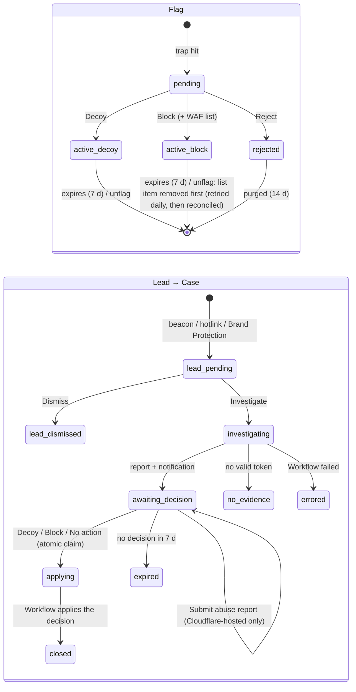

# `src/approvals/`: human decisions and enforcement

Every consequential action lives here. All human entry points call the same functions: the admin API and CLI, Discord buttons, and any future Slack or Telegram adapter. Nothing in this folder runs without an explicit human action, except `recordLead`, which only *records* a lead and asks a human.

| File | Purpose |
|---|---|
| `actions.ts` | `approveLeadAction`, `dismissLeadAction`, `decideCaseAction`, `approveFlagsAction`, `rejectFlagsAction`, `submitAbuseReportAction`. Each returns `{ ok, summary, notifyRef }` and never throws for expected refusals. State changes are atomic claims, so double clicks and concurrent approvers are safe: the loser gets *Not applied*. A decision moves the case to `applying` before the event is sent; an abuse report can be submitted at most once |
| `cases.ts` | `startInvestigation` (claims the lead atomically, refuses our own host and a second open case for the same host, which a D1 partial unique index also enforces; if the Workflow can't be created, the case becomes `errored` and the lead goes back to `pending`), plus decision parsing and sending |
| `enforce.ts` | `applyFlag`, `removeFlag`, [WAF List](https://developers.cloudflare.com/waf/tools/lists/custom-lists/) sync and the daily `reconcileWafList`. **Cloudflare IPs are protected** (`ProtectedIpError`). IP indicators must be a single IPv4 or IPv6 address (no CIDR ranges) and are stored in canonical form (`InvalidIndicatorError` otherwise). Each sync is one bulk write that waits for its [bulk operation](https://developers.cloudflare.com/api/resources/rules/subresources/lists/subresources/bulk_operations/methods/get/) and retries `429` with bounded backoff |
| `leads.ts` | `recordLead`: dedupes by host and notifies only on first sight; re-opens an investigated host after a re-scrape from a new scraper IP (see below) |

## Approval model

Every arrow labelled with an action needs a human, through a Discord button, the CLI or the admin API. [`src/notify/discord/README.md`](../notify/discord/README.md#what-the-buttons-do) explains exactly what each button does.



Case **Decoy** and **Block** create active flags for every scraper IP in the case, except Cloudflare IPs and IPs whose token says the fetch was a [verified bot](https://developers.cloudflare.com/bots/concepts/bot/verified-bots/) (both are listed in `decision.json`). Block flags reach the WAF list in one bulk write; if that keeps failing, the case still closes with `waf: ["error"]`, the Worker answers `403` for those IPs, and the daily reconcile adds the missing list items.

When a case decision (or a manual flag) replaces a flag from another source, for example a trap flag for the same IP, the old provenance is kept at the end of `reason`: `case …: copy found on … (previously trap <ray>: trap hit …)`.

## Lead sources

A lead is a foreign host that *might* run a copy of the site. Its `source` (the **Source** field in Discord, `source` in `npm run hp -- leads` and `GET /leads`) names the discovery channel that saw the host **first**, and so how much the lead proves on its own. Leads are deduplicated by host: a later signal from another channel only adds hits (a beacon also attaches its token), and `source` keeps its first value.

| `source` | Created by | What it means | Strength on its own | `hits` counts |
|---|---|---|---|---|
| `beacon` | `POST <BEACON_PATH>` ([honeypot](../honeypot/README.md)), as it happens | Our `rum.js` ran on a page on this host and reported a token that opens with our key. The lead keeps that token and the scraper IP inside it | **Strong.** A page on that host carried one of our tokens. Still unconfirmed until the capture finds it: anyone can load our page and post its token with an invented page URL (the `Origin` check stops browsers, not scripts) | beacon reports (bounded per host, per token and globally) |
| `referer` | Daily [`MaintenanceWorkflow`](../workflows/README.md#maintenanceworkflow-steps), from the last 2 days of Analytics Engine `hotlink` events (top 50 hosts) | Pages on this host load our images, scripts or stylesheets: a foreign `Referer` on a subresource load (link clicks don't count). Canonical hosts, `REFERER_IGNORE` and the built-in benign proxies are left out | **Medium.** Clones often hotlink assets, but so do partners, aggregators and blogs that embed one image | daily runs that saw the host |
| `brand_protection` | Daily `MaintenanceWorkflow`, from your [Brand Protection](https://developers.cloudflare.com/security-center/brand-protection/) string and logo queries (matches first seen in the last 2 days, at most 25 per run; needs `CF_API_TOKEN`) | Brand Protection matched the host against one of your queries: a recently seen domain whose name resembles a query string (typosquat, look-alike), or a page showing one of your logos | **Weak.** A match is about the name or the logo, not the HTML. Many are unrelated sites, parked domains or someone with a similar name. The lead doesn't record which query or logo matched; the Brand Protection dashboard does | daily runs that still saw the match as recent (usually 2 at most) |
| `manual` | Nothing today (reserved in the schema) | A URL you found yourself goes straight to a case with `npm run hp -- case <url>`, without a lead | n/a | n/a |

### Triaging a lead

**Investigate** is cheap and safe for every source. It captures one page and decodes it; URL Scanner and Threat Intel run only after a valid token is found, and a page without our token closes as `no_evidence` (the snapshot stays in R2). For a weak lead, a quick check first avoids an empty case:

1. Run `npm run hp -- decode <sample URL>`. It decodes the live page without storing anything or using quota. Like the capture, the fetch comes from your Worker and carries `CF-Worker: <your zone>`.
2. Decide:
   - **Error status** (`fetched.status` isn't 2xx and `fetched.error` is set; for example `530` with `cloudflareError: "1016"`, so no live site is behind the host): nothing was checked. Don't investigate yet, because the capture would get the same error page and close as `no_evidence`. Leave the lead pending, or dismiss it to clear the queue. Both are deleted 14 days after they were last seen, and after that a new signal creates a fresh lead and notifies again.
   - **Valid token:** click **Investigate**.
   - **No token, and the page is unrelated:** click **Dismiss**.
   - **No token, but the page plainly copies yours** (tokens stripped, or a re-skin): **Investigate** anyway to keep a dated snapshot. Without a token there is no attribution, so take it up with the host or registrar yourself.

## Re-scraped hosts

A lead is deduplicated by host. Once its host has been investigated (`approved`), further beacons only add hits, unless a beacon's token names a **different scraper IP**: the scraper refreshed the copy from somewhere else. Then `recordLead` re-opens the lead (`approved` → `pending`, with the new token as evidence) and notifies again ("Re-scraped clone"). The re-open is an atomic conditional `UPDATE` like every other claim, and it is refused when:
- the lead is `dismissed` (a human said to ignore the host);
- a case for the host is still open;
- the lead was re-opened less than 24 hours ago (`LEAD_REOPEN_COOLDOWN_SEC`), so a scraper rotating IPs can't flood the channel. Notifications are also bounded by `NOTIFY_LIMITER`.

A live reverse proxy always fetches from the same Worker egress, so it doesn't re-open on every visitor.

## Verified bots

Verified bots (search engines, monitoring, archivers; the [verified bots](https://developers.cloudflare.com/bots/concepts/bot/verified-bots/) list) are never enforced on. A Worker can't evaluate Rulesets fields such as [`cf.client.bot`](https://developers.cloudflare.com/ruleset-engine/rules-language/fields/reference/cf.client.bot/) or [`cf.bot_management.verified_bot`](https://developers.cloudflare.com/ruleset-engine/rules-language/fields/reference/cf.bot_management.verified_bot/) (they carry the same information). It reads the [Workers equivalents](https://developers.cloudflare.com/bots/reference/bot-management-variables/#workers-variables) instead: `request.cf.botManagement.verifiedBot` or `request.cf.verifiedBotCategory`. Either one sets the token's `verifiedBot` bit. Three layers use it:

| Where | What happens |
|---|---|
| Trap (`honeypot/trap.ts`) | A verified bot never becomes a pending flag |
| Case decision (`decisionTargets`) | IPs whose token has the bit are skipped (`skippedVerifiedBotIps`), so a clone made from a crawler's fetch can't get it blocked |
| Every request (`index.ts`) | A request from a verified bot is never decoyed or answered `403`, even if its IP carries an active flag (for example a manual one) |

Both signals come with [Bot Management](https://developers.cloudflare.com/bots/plans/bm-subscription/), which is why the README lists it as **required**: without it, `request.cf.botManagement` is absent (the [default since 2023-08-01](https://developers.cloudflare.com/workers/configuration/compatibility-flags/#bot-management-data)) and the Worker can't recognize verified bots. The edge rule then has to do it, and `cf.client.bot` is available on every plan. Write the block rule as `(http.host eq "<your-host>" and ip.src in $honeypot_blocked and not cf.client.bot)`, or put a verified-bot skip rule before it, as the demo zone does.

## Cloudflare IP ranges

Flags, decoys and WAF List items are **never** created for addresses in <https://api.cloudflare.com/client/v4/ips>. Those addresses are Cloudflare's own services or a customer's Worker (the `CF-Worker` header names the zone). Abuse coming from Cloudflare is handled with an [abuse report](../integrations/cloudflare/README.md#abuse-reports), not a block. The live list is fetched from the [IP ranges API](https://developers.cloudflare.com/api/resources/ips/methods/list/), and a bundled snapshot is the fallback.

## Usage

```bash
npm run hp -- approve-lead 12
```

```bash
npm run hp -- decide case-abc block 7
```

```bash
npm run hp -- approve-flags ip:203.0.113.7 --block
```

```bash
npm run hp -- abuse-report case-abc
```

The last one only works with `ABUSE_REPORTS="submit"`.
