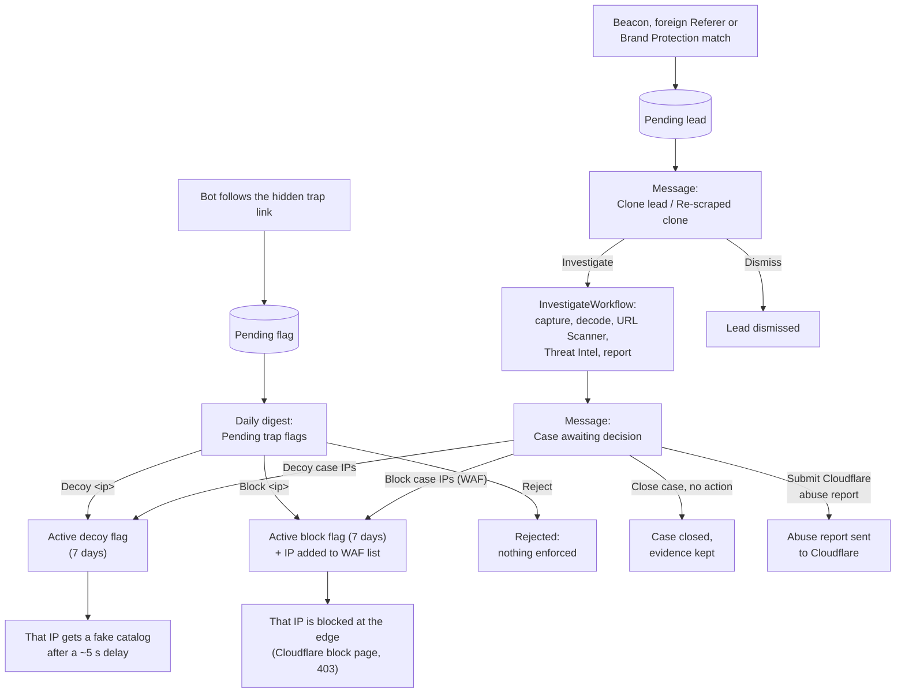
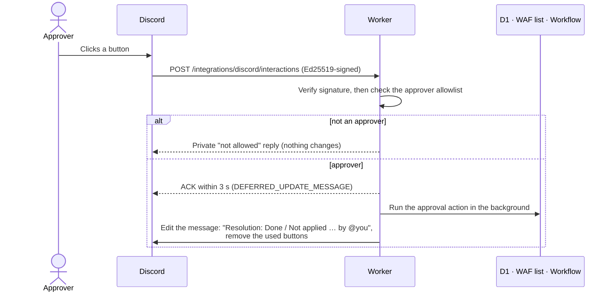

# `src/notify/discord/`: Discord approvals

The Discord adapter for the [notifier interface](../README.md). The Worker posts approval requests to a private channel. Approvers click buttons, Discord sends each click to the Worker's **Interactions Endpoint**, and the Worker runs the matching [approval action](../../approvals/README.md).

| File | Purpose |
|---|---|
| `api.ts` | REST client: create and edit messages, interaction webhooks, `429` retry. Sends a `DiscordBot (…)` User-Agent |
| `messages.ts` | Embeds and buttons for leads, cases and the flag digest; `custom_id` codec (`hp\|kind\|action\|arg`) |
| `notifier.ts` | `DiscordBotNotifier` (buttons) and `DiscordWebhookNotifier` (notify-only) |
| `verify.ts` | Ed25519 signature check: `X-Signature-Ed25519` over `X-Signature-Timestamp + body`, with a ±5 min replay window |
| `interactions.ts` | `POST /integrations/discord/interactions` |

## Setup (about 10 minutes)

1. **Create the app.** Go to <https://discord.com/developers/applications> and choose **New Application** (for example "Honeypot Approvals").
2. **General Information:** copy the **Application ID** (`DISCORD_APPLICATION_ID`) and the **Public Key** (`DISCORD_PUBLIC_KEY`). They aren't secret, but they're stored as Worker [**secrets**](https://developers.cloudflare.com/workers/configuration/secrets/) so they never appear in the public repo. Add them to `.dev.vars` (gitignored) and upload them with `--secrets-file` in step 6, or set each one with `npx wrangler secret put <NAME>`.
3. **Bot:** choose **Reset Token**, then store it as a secret. Never put it in `vars` or git.
   ```bash
   npx wrangler secret put DISCORD_BOT_TOKEN --env=""
   ```
   Turn **Public Bot** off. Gateway intents aren't needed, because this bot uses HTTP interactions only.
4. **Install the bot in your server** with View Channel, Send Messages, Embed Links and Read Message History (`84992`):
   ```text
   https://discord.com/oauth2/authorize?client_id=<APPLICATION_ID>&scope=bot&permissions=84992
   ```
5. **Channel and approvers:** create a private channel such as `#honeypot-approvals` and give the bot access.
   - Turn on *User Settings → Advanced → Developer Mode*.
   - Right-click the channel, choose **Copy Channel ID**, and put it in `DISCORD_CHANNEL_ID`.
   - Right-click yourself, choose **Copy User ID**, and put it in `DISCORD_APPROVER_IDS` (comma-separated). Alternatively, use role IDs in `DISCORD_APPROVER_ROLE_IDS`.
   - The **Check access** button in step 8 also shows your user ID.
   - If no approvers are configured, every click is refused.
   - All of these are secrets too.
6. **Deploy** ([`wrangler deploy --secrets-file`](https://developers.cloudflare.com/workers/wrangler/commands/workers/#deploy) uploads every secret in `.dev.vars`):
   ```bash
   npx wrangler deploy --secrets-file .dev.vars --env=""
   ```
7. **Interactions Endpoint URL:** under General Information, set
   ```text
   https://honeypot.automatic-demo.com/integrations/discord/interactions
   ```
   and save. Discord sends a signed `PING`, and the Worker answers `PONG`. Discord also sends invalid signatures from time to time; the Worker rejects those with `401` as required.
8. **Test:**
   ```bash
   npm run hp -- notify-test
   ```
   This posts a message with a **Check access** button. Clicking it replies only to you, confirms the endpoint works, and says whether you're an approver.

**Notify-only alternative (no buttons):**
1. In the channel, open *Edit Channel → Integrations → Webhooks → New Webhook* and copy the URL.
2. Store it:
   ```bash
   npx wrangler secret put DISCORD_WEBHOOK_URL --env=""
   ```
3. Set `NOTIFY_CHANNEL="discord-webhook"`.

Plain channel webhooks [cannot send interactive components](https://docs.discord.com/developers/resources/webhook), so these messages show the CLI commands instead of buttons.

## What the buttons do

The bot posts four kinds of messages. **Nothing is enforced until an approver clicks a button**, and only the IDs in `DISCORD_APPROVER_IDS` / `DISCORD_APPROVER_ROLE_IDS` can click.



### Pending trap flags (daily digest, top 5 by hits)

A trap flag is an IP that followed the hidden `/catalog/full-export` link. These links are disallowed in robots.txt and invisible to people. [Verified bots](https://developers.cloudflare.com/bots/concepts/bot/verified-bots/), visitors with a [bot score](https://developers.cloudflare.com/bots/concepts/bot-score/) ≥ 30, and [Cloudflare IPs](https://www.cloudflare.com/ips/) never become flags.

| Button | What changes | What that IP experiences | How long | Undo |
|---|---|---|---|---|
| **Decoy** `<ip>` | Flag becomes **active** with action `decoy` | Pages and `/api/*`: the real response is thrown away. After a **5–6 s delay** the IP gets a fake *Catalog export* page (or fake JSON) with status `200`, so nothing looks wrong. The decoy carries a fresh hidden token, so a republished decoy can be traced too. Static files (CSS, images, JS) are served normally | `FLAG_TTL_DAYS` (7 days), then removed by the daily maintenance run | `npm run hp -- unflag ip:<ip>` |
| **Block** `<ip>` | Flag becomes **active** with action `block`, and the IP is added to the `honeypot_blocked` [WAF IP list](https://developers.cloudflare.com/waf/tools/lists/custom-lists/) with the reason as comment | Every request to the honeypot host gets **Cloudflare's block page (403) at the edge**, before the Worker runs. If the list sync failed, the Worker itself answers `403` | 7 days; daily maintenance removes the WAF list item first and only then deletes the flag (a failed removal is retried the next day, and a daily reconcile catches leftovers) | `npm run hp -- unflag ip:<ip>` (also removes the WAF list item) |
| **Reject** | Flag becomes **rejected** | Nothing: the IP keeps getting the real site | The record is kept for up to 14 days (`PENDING_TTL_DAYS`) and then deleted. New trap hits in that time only raise its hit count and don't return to the digest | Nothing to undo. To enforce later, run `npm run hp -- flag <ip> decoy` |

**Choosing between them:**
- **Decoy:** waste the scraper's time and poison its copy without tipping it off.
- **Block:** stop the traffic outright. It's cheaper, because the Worker never runs, but the scraper notices and may rotate IPs.
- **Reject:** false positives, such as a human, a link-preview or email-security scanner, or a shared egress IP (corporate proxy, mobile carrier, iCloud Private Relay).

Blocking a shared IP affects everyone behind it, so check the IP before blocking (ROADMAP, "Shared and innocent IPs").

The digest buttons act on **one IP** and name it; the case buttons below act on **every IP in the case** and say "case". The labels differ on purpose: in the live test, an approver meant to decoy a trap flag and clicked the case's Decoy button instead. If an IP is both a pending trap flag and part of a case, deciding the case also activates that flag (its trap provenance is kept in the reason). The digest says so under that IP ("Also in case `case-…`: decide there"), and keeps its buttons in case you only want to reject the trap flag.

### Clone lead (first sight of a foreign host)

The message opens with what its **Source** means: `beacon` (a page on that host reported one of our tokens), `referer` (it loads our assets) or `brand_protection` (its name or a logo matched one of your [Brand Protection](https://developers.cloudflare.com/security-center/brand-protection/) queries; a look-alike, not proof of a copy). [Lead sources](../../approvals/README.md#lead-sources) explains each one and how to triage it.

| Button | What happens |
|---|---|
| **Investigate** | The lead becomes *approved* and **one** `InvestigateWorkflow` starts:<ul><li>captures the page and its SHA-256</li><li>decodes the hidden tokens</li><li>checks whether the copy is on Cloudflare</li><li>if a valid token is found, runs URL Scanner and Threat Intel</li><li>writes a report</li></ul>**Nothing is enforced.** It's refused (*Not applied*) if this host already has an open case. The result arrives later as a *Case awaiting decision* message. |
| **Dismiss** | The lead becomes *dismissed*. Later beacons from that host only raise its hit count; no new message and no Workflow. The record is deleted 14 days after it was last seen. |

**Re-scraped clone** is the same message for a host that was already investigated, sent when a visitor's beacon reports a token naming a **new scraper IP** (at most once per 24 hours per host; never for dismissed leads or while a case is open). The buttons behave as above; **Investigate** starts a new case with the new token as evidence.

**Investigation failed** is the same message, posted again when a lead's investigation errored (a step failed for good). The lead is back to `pending`, so **Investigate** retries and **Dismiss** drops it; the message names the errored case (`npm run hp -- case-status <id>`).

**Corroborated clone lead** is the original message of a pending `referer` or `brand_protection` lead, edited in place once a beacon reports a valid token from that host. It gains a *Corroborated by beacon* field with the token Ray ID, and its buttons stay. Discord doesn't notify anyone about an edit, so the title changes too, to stand out when you scroll back. If the lead has no message to edit, one new message is posted instead. It happens at most once per lead, never for dismissed or approved leads, and the token stays unconfirmed until **Investigate** finds it in the capture ([Corroborated leads](../../approvals/README.md#corroborated-leads)).

### Case awaiting decision (evidence report ready)

The case decision applies to **every IP that fetched the copied HTML**, meaning the IPs inside the tokens found on the copy. **Cloudflare IPs and verified bots are always skipped** (the attribution line says so).

If the title says **unconfirmed copy (beacon only)**, the investigator's capture found no token, and the only evidence is the token a visitor's browser reported for this host. The copy may hide its token from the investigator, or the beacon report may be forged. Open the URL Scanner report (or the page) before deciding. No abuse draft is written for such a case, so the abuse button doesn't appear. Attribution lines can also say **live reverse proxy** (the copy fetches your page for every visitor; the IP is the proxy, often a Cloudflare Worker named by its `CF-Worker` zone).

| Button | What happens |
|---|---|
| **Decoy case IPs** | Each of those IPs gets an active **decoy** flag (7 days, same effect as above). The case closes and the decision is saved as `decision.json` in R2. |
| **Block case IPs (WAF)** | Each of those IPs gets an active **block** flag and is added to the WAF list (7 days). The case closes. |
| **Close case, no action** | The case closes with no flags. The evidence bundle stays in R2. |
| **Submit Cloudflare abuse report** | Shown only when the copy is proxied by or hosted on Cloudflare, the capture holds a token (so a draft exists), **and** `ABUSE_REPORTS="submit"`.<ul><li>Submits the drafted report (DMCA by default) with your identity from `ABUSE_REPORTER_JSON`.</li><li>This is a **legal statement**, and Cloudflare forwards it to the host and site owner.</li><li>Only this button disappears; the decision buttons stay.</li></ul> |
| **URL Scanner report** | A plain link to the scan. It changes nothing. |

If nobody decides within **7 days**, the case expires and nothing is applied.

### Test message (`npm run hp -- notify-test`)

| Button | What happens |
|---|---|
| **Check access** | A private reply, visible only to you. It confirms the Interactions Endpoint works and shows your Discord user ID and whether you're an approver. It changes nothing. |

### What happens after any click



- **Resolution line.** It says what happened and who clicked:
  - `Done: decoy for ip:… by @you (7d, WAF: not_applicable)`
  - `Not applied: …`, for example when it was already handled, or when the IP is a Cloudflare IP and was rejected automatically
- **Which buttons are removed:**
  - **Digest:** only the clicked flag's row disappears; the other flags stay actionable.
  - **Lead or case decision:** all buttons are removed.
- **Double clicks are safe.** Every action claims its row atomically in D1, so a second click, or a second approver clicking at the same time, shows *Not applied* (for example "already decided by …").
- **Errors.** If an action fails, you get a private *Action failed* message. Lead approvals and case decisions roll back their claim when they fail. A flag approval can be partly applied (D1 updated, WAF list sync failed): check `npm run hp -- flags active`; the daily reconcile completes the WAF list.
- **What no button ever does:**
  - delete evidence
  - flag a Cloudflare IP
  - send anything outside Cloudflare (abuse reports only through the explicit button above)
- **TTL.** Buttons always use `FLAG_TTL_DAYS`. For a custom TTL, use the CLI:
  ```bash
  npm run hp -- approve-flags ip:203.0.113.7 --block
  ```
  Or call the admin API with `{"ttlDays": 30}`.

## Zone WAF note

Discord's requests come from Discord's infrastructure and look automated. If any rule challenges or blocks them, the endpoint setup in step 7 fails.

The interaction payload also echoes your message embeds back, including `<t:…>` timestamp markup that looks like HTML. That can trip OWASP or managed rules.

Add [**skip** rules](https://developers.cloudflare.com/waf/custom-rules/skip/) scoped as narrowly as the one below. The Worker still verifies every Ed25519 signature.
- **Custom rules:** skip the remaining custom rules (`ruleset: current`), placed above your block and challenge rules.
- **Managed rules:** add an [exception](https://developers.cloudflare.com/waf/managed-rules/waf-exceptions/) before the Cloudflare Managed and OWASP rulesets. Do this at zone level, and at account level if you deploy managed rules there.

```txt
(http.host eq "<your-host>" and http.request.method eq "POST" and http.request.uri.path eq "/integrations/discord/interactions"
 and ip.src.asnum eq 396982 and http.user_agent contains "Discord-Interactions/1.0 (+https://discord.com)" and cf.bot_management.score lt 30)
```

ASN 396982 is where Discord's interaction requests come from today. If Discord changes it, setup fails visibly. Loosen the ASN condition rather than the path.

## References

- Cloudflare: [WAF skip rules](https://developers.cloudflare.com/waf/custom-rules/skip/) · [WAF exceptions](https://developers.cloudflare.com/waf/managed-rules/waf-exceptions/) · [Rules language](https://developers.cloudflare.com/ruleset-engine/rules-language/expressions/) · [Bot score](https://developers.cloudflare.com/bots/concepts/bot-score/) · [Ed25519 in Web Crypto](https://developers.cloudflare.com/workers/runtime-apis/web-crypto/) · [`ctx.waitUntil`](https://developers.cloudflare.com/workers/runtime-apis/context/)
- Discord: [Bots overview](https://docs.discord.com/developers/bots/overview) · [Receiving and responding to interactions](https://docs.discord.com/developers/interactions/receiving-and-responding) · [Message components](https://docs.discord.com/developers/components/reference) · [Create Message](https://docs.discord.com/developers/resources/message) · [Permissions](https://docs.discord.com/developers/topics/permissions) · [Rate limits](https://docs.discord.com/developers/topics/rate-limits)
